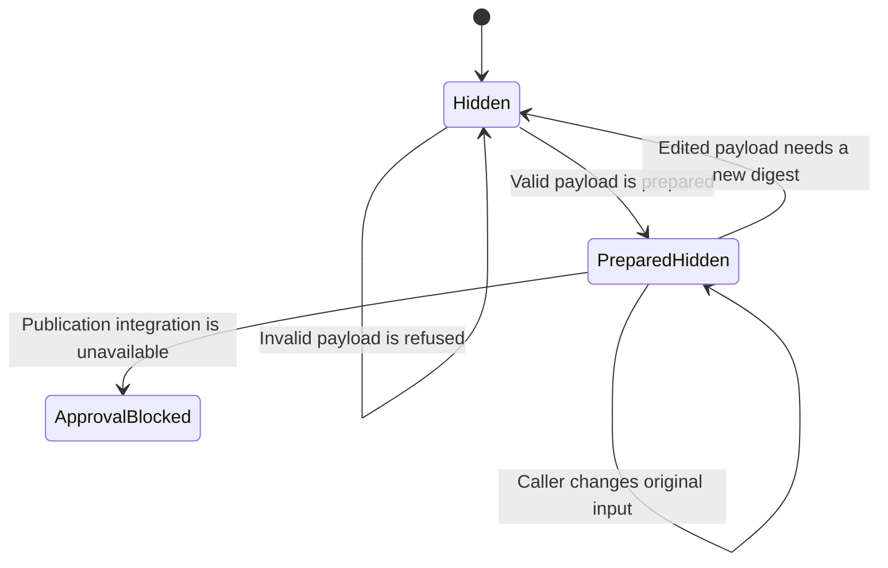

# Explainer publication preparation

This build is a partial producer prerequisite. It does not enable publication.
The S4 candidate at `541e47ffce83bbd6cb591545417be0dd91a3ea0c` is absent
from main at `f26f8b19e86faa038d7fe64898131444f37b06ed`. The coordinator
must supply the existing S19 approval-record schema before integration.

## System design

The data shape is a closed explainer payload with `kind`, `section_key`,
`title`, and rich-text `paragraphs`. CARR owns validation and canonical digest
preparation. Preparation returns a detached frozen revision. It grants no
review or publication authority. The existing publication module will own
portal locking, optimistic versions, and explicit publication after S4 lands.

Two designs were considered locally under the no-children instruction.
A new publication ledger would duplicate S4 authority. A pure revision
preparer leaves that authority with S4 and is the selected partial design.

At current and tenfold portal counts, preparation has constant bounded work
per revision. The first limit is 32 KiB of canonical UTF-8 JSON, including
all reviewed fields. There are at most twenty paragraphs and thirty-two runs
per paragraph. The later projection must cap explainers at two and enforce
one active section key per portal in PostgreSQL.

There is no cache, shared mutable state, queue, fan-out, network call, send,
or database access in preparation. Load spreads across independent calls.
Invalid input fails before digest preparation. No external-call breaker,
rate, retry, idempotency key, eviction, or stale-read policy applies to this
pure function. Equal payloads produce equal digests across object key order.
No storage, concurrency, N+1, or transaction claims are made by these tests.

The future publication transaction must reuse S4 envelope idempotency and
portal locks. Preview and client reads must use the same snapshot projection.
They must omit unpublished, withdrawn, cross-portal, missing-review,
revoked-review, and digest-mismatched items. A newer approved draft must not
replace an active revision without an explicit publication write.

## Statechart

These states describe this partial build. No transition to client visibility
exists. Schema refusal, digest change, and detached immutable results have
executable tests. `ApprovalBlocked` records a missing dependency rather than
an implemented publish action. This chart is not a checked TLA+ model.

## Throughput checkpoint

- Blocking first steps. Inspect main, S4, contract validation, and open PR files.
- Independent workstreams. None. Schema and preparation share one payload shape.
- Shared mutable state. None. Each preparation returns a detached frozen value.
- Smallest safe decomposition. One worker owns schema, preparation, and tests.

## Remaining evidence

Supply the safe schema and authoritative read path for successful lint,
independent review, and partner decision records. Each must bind the exact
payload digest and expose revocation or supersession. Supply S4 on main.
Then implement immutable persistence, the active-key constraint, optimistic
publication, withdrawal, shared projection, and real ephemeral PostgreSQL
transition and concurrency tests. No approval receipt is synthesized here.

Production proof remains pending. After signoff and deployment, the
coordinator must compare publication IDs, versions, and reviewed digests
between partner preview and authenticated client reads. This build performs
no content approval, publication, withdrawal, or production effect.
