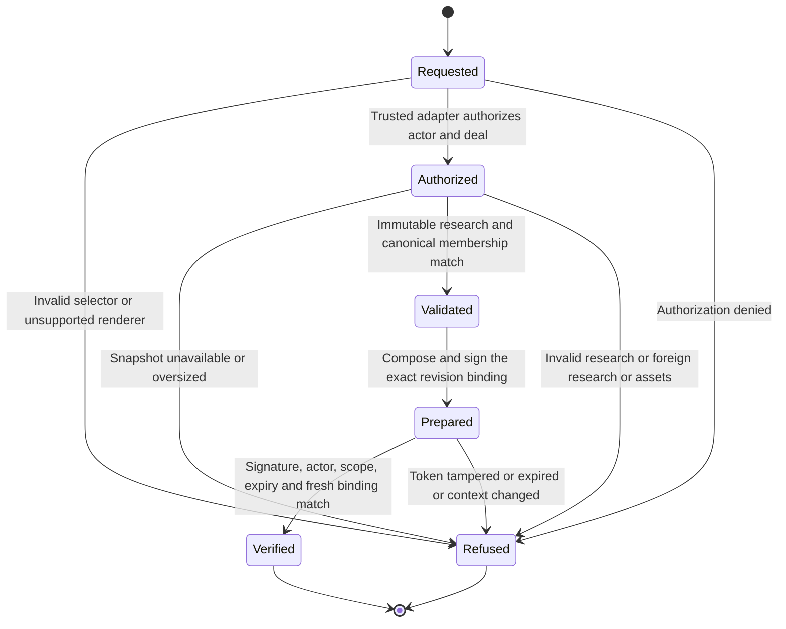

# Market study preparation

This branch contains a preparation core, not a registered production workflow.
The canonical snapshot adapter and runtime signing binding remain integration
prerequisites. No package or overlay store is invented by this module.

Preparation never publishes. Verification never grants publication authority.
The later publication owner must read a fresh canonical snapshot and verify it
inside its own publication transaction.

## System design

The data shape is an authorized immutable research snapshot, reviewed record
groups, canonical asset envelopes, and a revision map. The trusted server adapter
owns authorization, snapshot consistency and provenance. The core owns size and
work limits, composition, hashing and token verification. Browser selectors
contain only deal, package, version and renderer. The adapter must not be exposed
as a caller-supplied input.

Two designs were considered. A database adapter inside this module would bind
SQL to nonexistent package and overlay relations. A trusted snapshot interface
keeps the composition and token contract testable without guessing those
relations. The latter is the partial implementation. Registration waits for the
real adapter, not a fallback that manufactures membership assertions.

Capacity is bounded to 2 MiB of input and output, 20 properties, 200 assets,
200 revision entries, depth 64 and 100,000 JSON nodes per snapshot. Tests exercise
2 and 20 properties. At 10x demand, requests spread across stateless instances;
CPU and memory per request hit these limits first. No throughput claim is made.
There is no cache or eviction policy because no candidate persists server-side.

Availability is sequential and fail-closed. Authorization precedes snapshot
loading. Failed reads, validation or signing return no candidate. There are no
external calls in the core, no retries, queues, producers, sends or writes.
Idempotency is n/a because preparation has zero persistent effects. A caller
must rate-limit requests using the authenticated runtime budget.

The missing Postgres adapter must use bounded set queries at one consistent
snapshot, independently of property count. Strict consistency is required for
all consumed inputs. It must supply revisions for deal, client, property
membership, every reviewed input, asset membership and current publication.
The core binds the entire revision map and all canonical input bytes, so a
changed consumed value also invalidates verification even if a producer fails
to advance its revision. A row version on the deal alone cannot satisfy the map.
Database failure stops the request. The adapter must have a deadline and no
retry loop. Query counts and real PostgreSQL behavior remain unproven.

Signing uses only an injected runtime CryptoKey. No default key, source secret,
or process-global key exists. Missing binding fails closed. Tokens expire after
five minutes and bind actor, authorization scope, deal, client, immutable
research identity and digest, overlay revisions and digest, asset membership,
current publication revision, composed digest, schema, composer and renderer.

## Throughput checkpoint

- Blocking first steps. Inspect current main and all open PR file sets before editing.
- Independent workstreams. n/a. One coupled contract and core stay with this worker.
- Shared mutable state. No persisted state, cache or shared token key mutation.
- Smallest safe decomposition. One worker tests the core; the coordinator resolves the missing canonical adapter and dispatches review.

## Integration remainder

At inspected main `d10f593f426a290382fec1b65934a7a02694e033`, the S4 candidate
`541e47ffce83bbd6cb591545417be0dd91a3ea0c` is not an ancestor and its
`client-publications.js` and publication migration are absent. The canonical
schema has no immutable market-study research catalog or reviewed package-group
projection. Existing Tour assertions are not the market-study schema. Reusing
them requires an explicit mapping and provenance contract. Full acceptance needs
the canonical adapter, runtime binding and tool registration, real PostgreSQL
query-count tests, current publication readback and integrated production proof.

## Transition coverage

| Transition | Executed test |
| --- | --- |
| Requested to Refused, selector | caller cannot supply membership, reviewed data or revisions |
| Requested to Refused, renderer | rejects invalid research and unsupported renderer |
| Requested to Authorized | prepares and verifies 2 properties without publication effects |
| Requested to Refused, authorization | unauthorized actor never reads catalog or snapshot |
| Authorized to Refused, unavailable | refuses foreign snapshot |
| Authorized to Refused, bounds | refuses oversized bytes; refuses too many properties; refuses too many assets |
| Authorized to Validated | prepares and verifies 20 properties without publication effects |
| Authorized to Refused, provenance | rejects foreign package and foreign assets before issuing a preview |
| Authorized to Refused, validation | rejects invalid research and unsupported renderer |
| Validated to Prepared | binding pins exact composer, validator and schema bytes |
| Prepared to Verified | prepares and verifies 2 properties without publication effects |
| Prepared to Refused, token | rejects expired, tampered and actor-substituted tokens |
| Prepared to Refused, stale | changing canonical revision publication invalidates the candidate; changing consumed client bytes invalidates binding even with unchanged revisions |
| Verified to terminal | prepares and verifies 20 properties without publication effects |
| Refused to terminal | adapter failures do not retry or return partial candidates |

The tests exercise the core interface with a synthetic trusted adapter. They do
not prove database authorization, persisted package immutability, SQL query
counts or zero publication changes in PostgreSQL. Those remain required.
