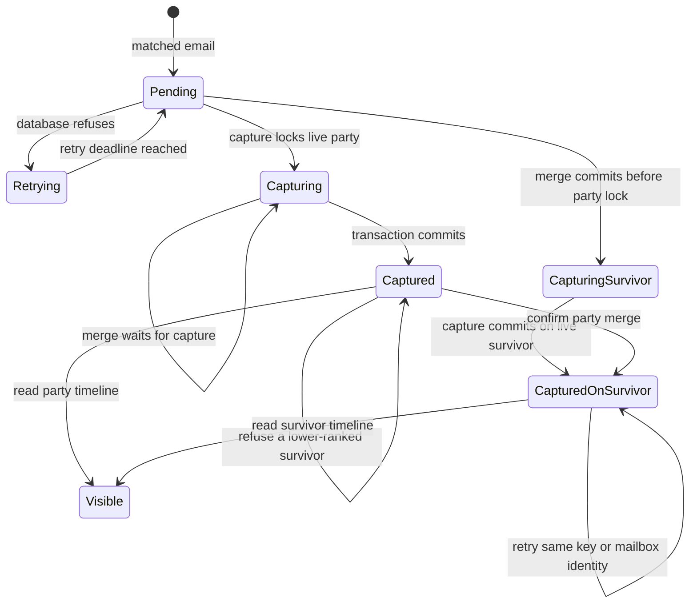

# Bare-party intake capture

The retained write queue owns the original idempotency key and payload. The registered
log-activity handler resolves the subject and atomically stores its activity, event and
receipt. Postgres owns party identity through a foreign key. The receipt reports the
current retained Message-ID count even when another write fails.

Tests map Pending to Capturing to Captured, Captured to Captured and Captured to Visible to
`intake captures bare-party email and retries without duplicating its timeline`.
The existing `test_a_failed_write_fails_the_run_and_is_retried_next_time` covers
Pending to Retrying to Pending to Captured. `test_failed_write_receipt_counts_retained_mail_ids`
covers a failed run retaining its snapshot count. `test_every_receipt_includes_zero_mail_ids_when_no_snapshot_exists`
covers the absence of a readable snapshot.

System design uses existing sequential intake and atomic, idempotent CARR writes.
No new API, queue, cache, external call, retry policy, fan-out or circuit breaker is added.
At ten times the intake volume the existing bounded intake cadence and write transport
remain the limiting components. The new partial party timeline index supports the same
subject lookup pattern as the existing role indexes. A separate party branch
preserves the indexed role expressions in the existing timeline projection. Reads refuse a database error.
No stale cache or additional N+1 query is introduced. Deployment must apply the additive
migration before the changed handler. Existing role activities remain unchanged.

Alternative considered was removing bare parties from matching. That would discard a
supported contact class and strand the retained requests. Party storage preserves the
resolved subject instead of inventing a lead or client role.

The test `party merge preserves captured mail and mailbox replay on the survivor`
covers the lower-ranked survivor refusal, the merge transfer, replay with the old
key and new keys using either party ref, and survivor timeline visibility. It
asserts the moved activity count in the response and event, the attachment sweep,
and direct activity survivorship precedence.

Merge transfers direct activity in the existing transaction. Mailbox replay also
checks the current party attachment, preserving immutable email identity and
historical event and receipt evidence.
Direct activities count alongside role activities in survivorship and attachment
reporting. Refusing all party-mail merges was considered; moving these rows safely
uses the existing locks and transaction without adding a resolution workflow.

Concurrent capture follows the merge pointer chain and locks only the current
survivor FOR SHARE before mailbox replay or insertion. confirm-merge takes
FOR UPDATE on both endpoints before scoring or transferring activities.
Capture-first therefore commits before merge reads the activities. Merge-first
captures directly on the survivor. The retained payload and key remain unchanged.
The lock query rechecks merged_into and deleted_at after waiting. If the selected
survivor itself retires during the wait, the write refuses email_touch_target_not_live
and retry follows the new chain. It never locks the retired ancestors, so it cannot
invert merge endpoint lock ordering. No successful new attachment lands on a retired
party. Exact receipt replay preserves historical responses, and mailbox replay
matches the current attachment while preserving immutable source identity.

The test `concurrent party capture and merge preserve mail in either lock order`
covers Pending to Capturing to Captured to CapturedOnSurvivor in
`capture first waits then merge transfers mail`. It covers Capturing to Capturing
by observing the blocked merge, then checks transfer and replay.
`merge first redirects retained capture and retry succeeds` covers Pending to
CapturingSurvivor to CapturedOnSurvivor. It checks successful capture on the survivor,
unchanged payload retry, physical attachment, survivor timeline and mailbox replay.
Both use two real PostgreSQL connections and bound merge statements with a timeout.

Role captures reference the role row, whose party_id moves in the merge.
Their activity foreign key remains valid, so they do not have this direct-party
attachment race. This lock changes only direct-party capture resolution.

Refusing all captures against a retired original ref was rejected after checking
lib/outlook_intake.py. The retained request retries its original payload, so refusal
alone would keep that request failing. Following the pointer in the lock query
recovers the retained request without a new queue or a client retry workaround.
