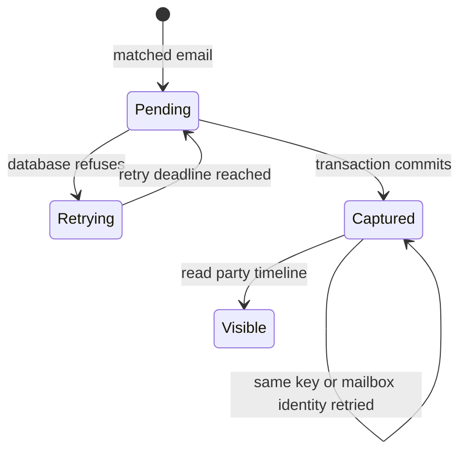

# Bare-party intake capture

The retained write queue owns the original idempotency key and payload. The registered
log-activity handler resolves the subject and atomically stores its activity, event and
receipt. Postgres owns party identity through a foreign key. The receipt reports the
current retained Message-ID count even when another write fails.

Tests map Pending to Captured, Captured to Captured and Captured to Visible to
`intake captures bare-party email and retries without duplicating its timeline`.
The existing `test_a_failed_write_fails_the_run_and_is_retried_next_time` covers
Pending to Retrying to Pending to Captured. `test_failed_write_receipt_counts_retained_mail_ids`
covers a failed run retaining its snapshot count. `test_every_receipt_includes_zero_mail_ids_when_no_snapshot_exists`
covers the absence of a readable snapshot.

System design uses existing sequential intake and atomic, idempotent CARR writes.
No new API, queue, cache, external call, retry policy, fan-out or circuit breaker is added.
At ten times the intake volume the existing bounded intake cadence and write transport
remain the limiting components. The new partial party timeline index supports the same
subject lookup pattern as the existing role indexes. A separate party branch
preserves the indexed role expressions in the existing timeline projection. Reads refuse a database error.
No stale cache or additional N+1 query is introduced. Deployment must apply the additive
migration before the changed handler. Existing role activities remain unchanged.

Alternative considered was removing bare parties from matching. That would discard a
supported contact class and strand the retained requests. Party storage preserves the
resolved subject instead of inventing a lead or client role.
