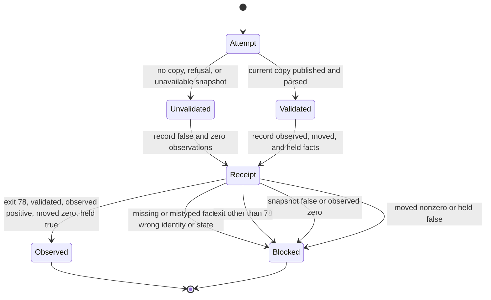

# Producer containment receipt outcomes

The receipt owns current-attempt facts. A retained snapshot never supplies them.

Tests enumerate each observer transition, every missing field, incorrect types,
and exit 0 with moves while held. The real combined CLI test uses the existing
synthetic decoded research copy and decoder fixture, with no mailbox access.
The old successful-receipt observer must continue refusing skipped receipts.
This finite decision chart omits producer internals and trusted evidence ingestion.

## System design

Architecture and consistency. The existing Report owns attempt facts. The receipt
writer serializes them once, including the process exit code. A dedicated
studio-triage-containment.v1 observer refuses incomplete or inconsistent facts.
It never reads retained snapshots or treats a skipped run as successful filing.
The scheduled wrapper preserves the exact typed triage shape in its durable
receipt and continues rejecting arbitrary content and other service shapes.
The existing studio-run-receipt.v1 source pin remains unchanged.

Capacity, load spread, storage and scaling. One local receipt per invocation,
bounded to 1 MiB, constant work except bounded JSON parsing. At 10x invocation
volume no shared state is added. Oversized receipts refuse before parsing.
No database access or N+1 reads.

Availability. Producer failure yields unvalidated facts. Receipt read, parse,
identity and predicate failures refuse. There are no retries or fallbacks.
Caching and invalidation are n/a because each receipt describes one attempt.
Async, queues, circuit breakers, external rate limits, and idempotency keys are
n/a because the observer performs one local read and no writes or external calls.
The existing producer limits and write semantics remain unchanged.
