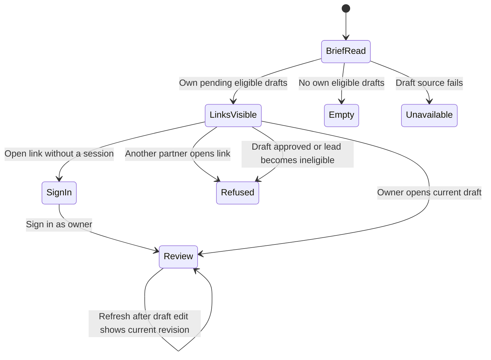

# Morning draft links

Sizing: one-session bounded integration. No resolver, app, migration or AI-output changes.

## Grounding

`morning-brief` composes read-only sections in `tools.js`. `lead-approval-queue`
selects first-contact drafts ordered by scheduled instant and ID, but is an
unbounded shared queue. `action-links.js` owns stable references and resolution.
`lead-draft-eligibility.js` owns current-party and qualified/active eligibility.
The resolver checks the signed-in actor's ownership before eligibility, and reads
the current revision. Approval remains an explicit, separate human command.

## System design

- Architecture and data: add `sections.lead_drafts` to the existing composer.
  Return draft metadata and the canonical `buildActionLink` result under
  `action_link`. Postgres owns draft/revision/ownership. No new persisted data.
- Alternatives: reuse `lead-approval-queue` then filter in memory, or query the
  eligible owned subset with a SQL limit. Choose the latter to avoid unbounded
  reads and exposure of other owners' draft bodies. Reuse canonical eligibility.
- Capacity and scaling: one query and at most 20 returned rows per brief at
  current and 10x load. Database scan/sort is the first scaling constraint.
  No per-draft queries or external network calls. Existing connection limits apply.
- Load spread: existing Worker and Postgres routing. No new fan-out.
- Caching: none. Eligibility is read live; stable links resolve current revisions.
- Availability: existing sequential section composition. A failed draft read is
  unavailable with no driver details; other sections survive. No retries.
- Storage: one ordered join through draft, current lead party and owner actor.
  Existing scheduled_for/ID ordering is retained. No N+1.
- Consistency: no snapshot promised across brief and later click. Current revision
  resolves on click; approved or ineligible drafts refuse. Never serve stale authority.
- Async: n/a, reference construction is synchronous and no queue is created.
- Circuit breakers: n/a, no external call introduced. One failed DB read ends this
  section as unavailable with the existing coverage signal, without a retry loop.
- Limits: SQL LIMIT 20; no loop sends or API fan-out.
- Idempotency: n/a, only SELECT and deterministic reference construction; no write.

## Statechart

No read or open transition approves or sends. The existing app owns sign-in and
review rendering; source tests prove producer and resolver behavior, not UI.

## Throughput checkpoint

- Blocking first steps: read source, main, unit registry and open PR file overlap.
- Independent workstreams: n/a, one coupled composer and acceptance fixture.
- Shared mutable state: private T3 branch; disposable Postgres fixture per test.
- Smallest safe decomposition: one worker owns producer, fixtures and proof declaration.

## Design and debt pass

Codebase-design: use existing composer and canonical builder, no pass-through module.
Zero-tech-debt: one eligibility predicate, no new token, resolver or compatibility route.
