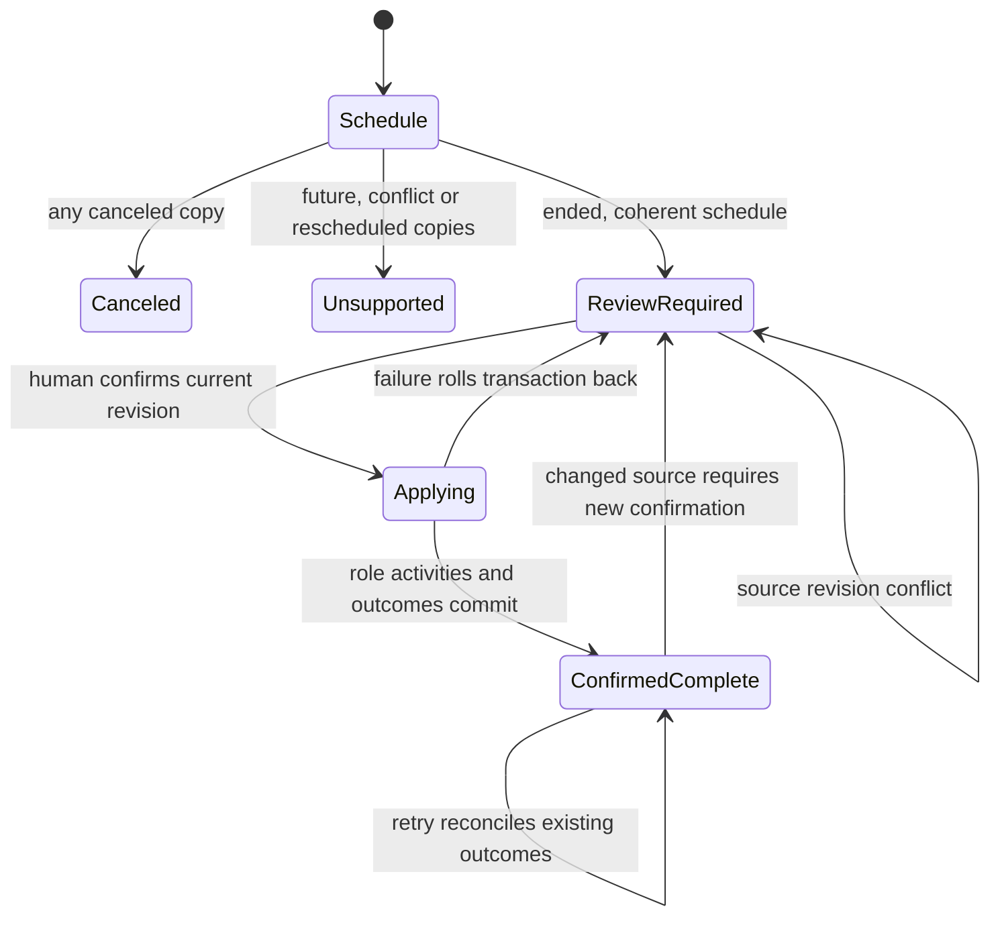

# Completed meeting confirmation

No automatic completion source is qualified by this implementation. Undo of an
automatic application is therefore unreachable. Human-confirmed activity remains
ordinary auditable activity. Schedule revisions never erase historical touches.

Crash and partial-success tests fail after the first activity and roll back, then
retry. Revision and version-conflict tests reject a stale revision before writes.
Repeated confirmations reuse the event/role outcome independently of revision.
Canceled, future, changed-time and unknown participant tests assert zero touches.

## System design

Intake owns schedule evidence and exact resolution. Agenda owns canonical event
identity, source revision and review proposals. Confirmation owns the accepted
revision, unresolved hashes and per-role activity readback. log-activity owns
touch effects. A caller-managed resolve/apply interface was rejected because it
spreads stale-evidence and retry rules across callers. One confirmation operation
keeps those rules together inside the existing transaction. Its private activity
writer is the adoption seam for WR634.S1.J134. No J134 branch or PR appeared in
the initial remote census.

The brief reports 191 candidates. At 10x, scanning contacts and per-role writes
break first. Resolution reads contacts once and canonical role targets once,
without a query per attendee. Role writes are bounded by the 50-attendee evidence
limit. Resolution has no cache. The locked snapshot is the evidence authority.
There are no external calls, so external timeouts, rate caps and breakers are
n/a. Database lock waits are bounded at five seconds and statements at ten seconds. Queues
are n/a because confirmation is synchronous.

The event lock serializes confirmations and the snapshot share lock excludes
concurrent replacement. The enclosing transaction commits activities and outcomes
together. Failure rolls back all roles. Stable event/role keys and persisted
outcomes handle retries and revisions. Canceled and unsupported schedule evidence
keeps separate dispositions and writes no activities. Unknown or ambiguous
attendees never produce guessed targets.

No authoritative completion provider is admitted. Cache lifecycle cannot apply
automatically. An automatic undo is unreachable. Human-confirmed activities stay
ordinary auditable activities. This is not a generic automatic-completion API.

## Client contract

Use the existing answer-board-question review action with board_id calendar-agenda,
question_id equal to the displayed key, base_version 1, answer_text Confirm completed
and source_revision from the review. completion.outcomes includes role, canonical
target and activity ID. A deal is optional. A deal confirmation can still use
log-activity with calendar_event_key plus calendar_source_revision. The key never
passes to role activities. Old clients must carry the displayed revision before
rollout. Dismiss is unchanged. Old evidence stays displayable but cannot authorize
touches. Stale revisions require refreshing the review.

## Verification model

TLC reached five states and eight steps. NoDuplicate, NoUnconfirmedTouch and
NoDeadlock hold. The model assumes atomic transactions and excludes matching and
schedule classification. The diagram above includes classification beyond the
small TLC model. Real database tests replay rollback after the first role write,
retry, stale revision, later revision and confirmation under carr_writer.
The retry self-loop is omitted in the generated chart. Rerun the installed
pstack statechart script with Completion.tla and a fresh output directory.

## Design and debt pass

codebase-design keeps evidence, canonical resolution and application behind one
confirmation interface with one private activity-writing seam.
zero-tech-debt reuses the existing review action, contact reader, transaction
and log-activity rather than adding another queue or touch-writing path.

## Production proof

proofs/requirements/wr636-completed-meeting-touches.json

Pending coordinator deployment and a natural installed run. Local synthetic
proofs do not establish production acceptance.
