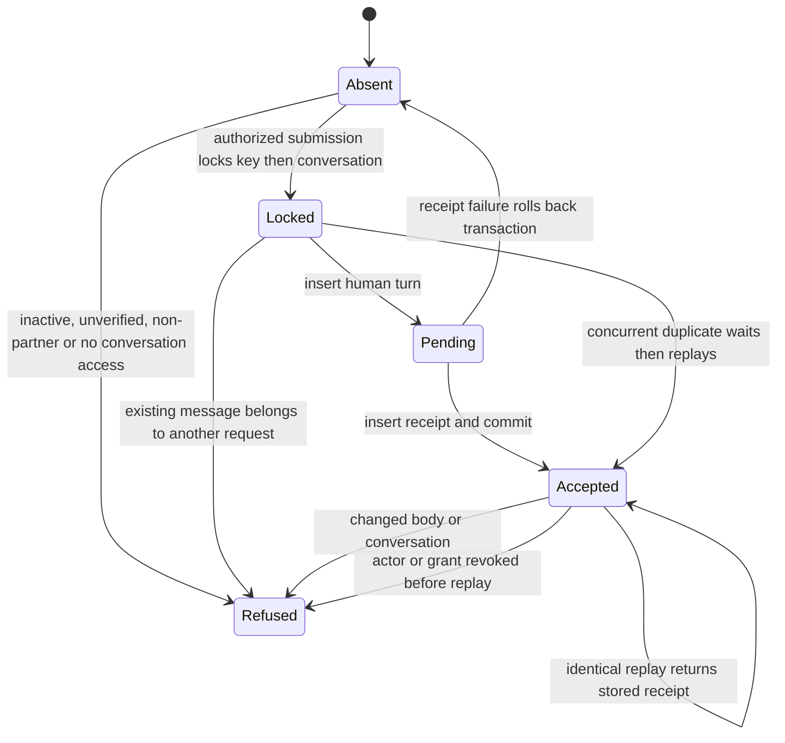

# Queued ask submission

The data shape is an immutable request `(actor, key, conversation, body)` and its accepted receipt.
The public seam takes only key, conversation and body. Authenticated transaction context supplies actor.

Invariants checked against disposable PostgreSQL.

- Each accepted actor/key has one human turn and one immutable receipt.
- A receipt binds the exact body and conversation. Another key is a new request, never a replay.
- Revocation prevents submission and replay. Refusal never inserts an ask or receipt.
- Concurrent requests serialize sequence allocation on the conversation header.
- A failure between turn and receipt leaves neither. No intermediate state is committed.

Tests follow each transition in `../../doc-conversation-postgres.test.mjs`.

Design alternatives considered locally because this worker cannot delegate. Extending the generic
`tool_call` envelope would use a global, expiring key and replay before checking current access.
A dedicated actor/key receipt behind one partner-only definer keeps durable replay, authorization,
serialization and atomicity together. The handler validates transport fields and returns only the
versioned result. Existing completion still consumes the canonical human turn.

The bounded model includes one new actor/key request, one assistant answer and an earlier
human turn. Both writers acquire the conversation header before sequence allocation.
It excludes answer generation, HTTP retries and browser storage. PostgreSQL tests cover
exact argument comparisons, cross-actor collisions, ACLs and more than one request key.

TLC checks AtomicCommitted, AtMostOnce, ConsecutiveTurns, ExclusiveAllocation and
NoDeadlock. The regenerated summary has 20 model states, 33 model transitions,
14 chart states and 24 chart transitions. The PNG was rendered and inspected.
Self-transitions for waits, replay, duplicate and refusal are hidden in the chart.

| Model action | Named PostgreSQL test |
| --- | --- |
| Submit, Commit | partner submission stores one ask and contract receipt |
| Rollback | receipt insert failure rolls back ask and receipt together |
| Answer, AnswerCommit, Wait (ask first) | concurrent ask first serializes queued ask and assistant answer |
| Answer, AnswerCommit, Wait (answer first) | concurrent answer first serializes queued ask and assistant answer |
| AnswerRollback | assistant rollback releases allocation for the queued ask |
| Revoke | unauthorized and revoked access refuse before writes including replay |
| Replay | immutable replay and body or conversation mismatch |
| Duplicate | concurrent duplicate submissions store one ask |
| Refuse | inactive and unverified actors and non-partners cannot submit directly |

The race tests call the actual registered tools in separate carr_writer and carr_authority
transactions. They observe the second backend blocked by the first, commit both, and
assert three consecutive persisted turns and one receipt. The ask-first test fails on
c15575e8c0ff75cbe63da5d252efec822196b724 with the sequence unique constraint.

Regenerate outside the repository after copying DocRequest.tla, DocRequest.cfg and view.mjs
to /tmp/j13-model. Set JAVA and TLA2TOOLS to installed tools, then run the installed
statechart runner with `from-spec /tmp/j13-model/DocRequest.tla --map /tmp/j13-model/view.mjs
--out /tmp/j13-model-result --png`. The chart and report are copied back from that output.
