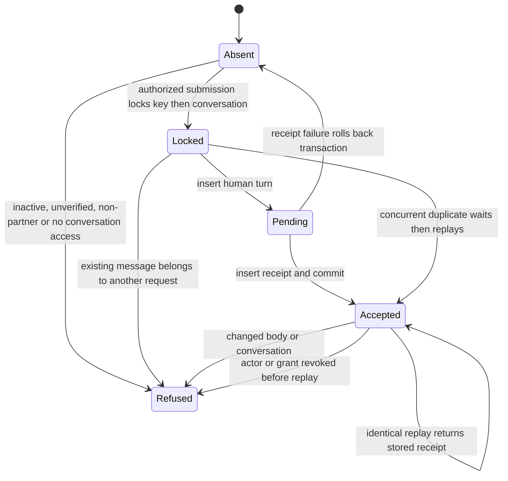

# Queued ask submission

The data shape is an immutable request `(actor, key, conversation, body)` and its accepted receipt.
The public seam takes only key, conversation and body. Authenticated transaction context supplies actor.

Invariants checked against disposable PostgreSQL.

- Each accepted actor/key has one human turn and one immutable receipt.
- A receipt binds the exact body and conversation. Another key is a new request, never a replay.
- Revocation prevents submission and replay. Refusal never inserts an ask or receipt.
- Concurrent requests serialize sequence allocation on the conversation header.
- A failure between turn and receipt leaves neither. No intermediate state is committed.

Tests follow each transition in `../../doc-conversation-postgres.test.mjs`.

Design alternatives considered locally because this worker cannot delegate. Extending the generic
`tool_call` envelope would use a global, expiring key and replay before checking current access.
A dedicated actor/key receipt behind one partner-only definer keeps durable replay, authorization,
serialization and atomicity together. The handler validates transport fields and returns only the
versioned result. Existing completion still consumes the canonical human turn.

The model excludes HTTP retries and browser storage, owned by app PR 641, and answer generation.
TLC checked the bounded model in `DocRequest.tla`, reaching 5 states and 10 steps with
AtomicCommitted, AtMostOnce and NoDeadlock holding. Replay, duplicate and refusal
self-transitions are hidden in the generated chart. The model abstracts one actor/key
and database transactions; multi-actor collisions and exact request comparisons are
proved by PostgreSQL tests. Reproduce with the installed statechart runner on
`DocRequest.tla --config DocRequest.cfg --view view.mjs --out /tmp/doc-request-model`. Set TLA2TOOLS
and JAVA to installed tools if mise is unavailable.
