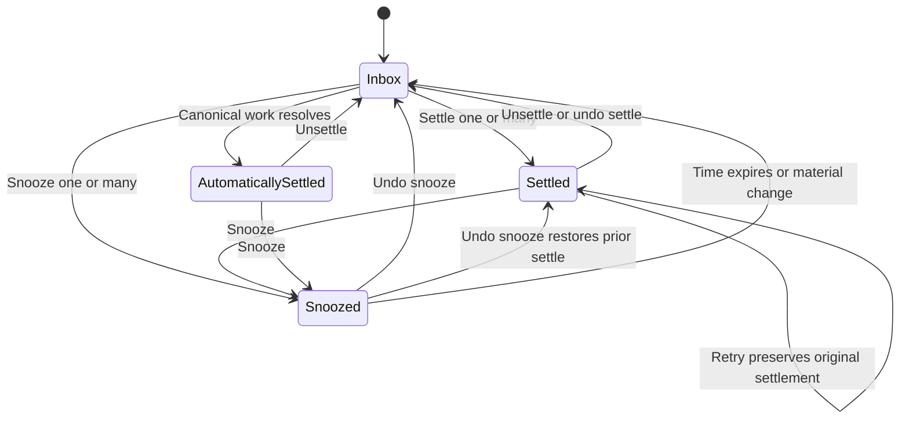

# Home disposition history

Sizing is one session. Postgres owns actor-local disposition state and transition evidence. MCP adds Home v6 and a bounded recent-settles read. Existing commands and exact undo receipts remain the write interface.

Never invent legacy times. Manual changes carry actor, server time, method and request key. Bulk shares its request key as batch ID. Replay writes no second event. Unsettle clears current settlement. Exact undo restores prior settlement metadata. Automatic settlement uses proven completion evidence, null human actor and automatic method. Unknown completion stays null. Reads never write. Failed items produce no events.

## System design

Choose disposition metadata plus a private command ledger over deriving times from updated_at. updated_at cannot distinguish commands or survive exact undo. Metadata in receipt snapshots allows atomic restoration. The ledger preserves undo time separately.

The existing actor advisory lock serializes commands and audit in one transaction. No queue, cache, external calls, fan-out, circuit breaker or external rate limiter applies. Database failures roll back state and audit. Writes retain idempotency keys and the 100-item cap. Home reads cap at 1000; recent results cap at 100. One snapshot and indexed actor/item lookups avoid client N+1. At 10x load the canonical source projection and completion evidence scan break first. Ledger grows per successful manual item; actor/item index serves latest transitions. No evidence is backfilled. Contracts v1-v5 remain unchanged.

Tests derive from these transitions. Canonical domain mutations and notification delivery remain covered by existing Home tests. Automatic evidence is a projection, never a read-time event.
