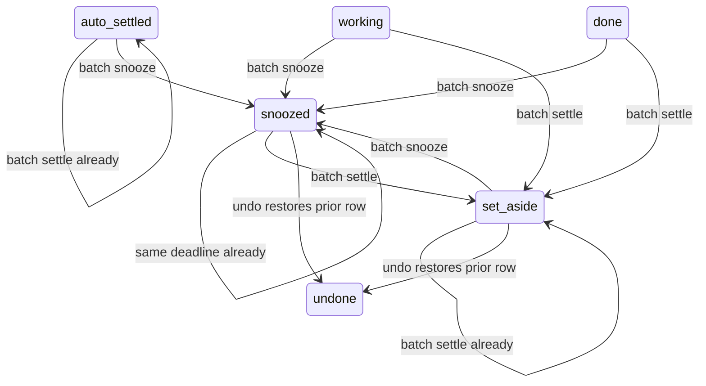

# Reversible Home batches

Size L01: medium, one database transaction seam plus existing command adapters.

Design A adds a bulk command and a separate undo verb. Design B adds optional
`reversible: true` and `undo_of` to existing snooze/settle commands. Choose B.
It preserves deployed calls and reuses the only settlement command.
`undo_of` names the original idempotency key. Omit items to undo the whole batch,
or supply original item keys to undo a subset. No-op receipts never restore rows.
Undo refuses intervening changes rather than overwriting newer work.

Data shape: actor-owned batch receipt with per-item prior disposition row,
after version, outcome and undone marker. One actor lock serializes dispositions.
Per-item savepoints isolate failures. No new item state is introduced.

Undone means the exact saved disposition is restored, not a persisted item state.
Tests named `bulk statechart <state> <command> <mode> exact undo` cover Apply,
UndoAll and UndoOne transitions for working, done, auto-settled, set-aside, snoozed and explicit override.
Mixed receipts cover not found, forbidden and stale items. Subset cases keep a second selected item changed, then undo the remaining batch.
Every case compares the exact prior row and visible state and checks replay.
The snoozed subset-settle case fails when saved snoozed-row restoration is removed.
Separate tests cover concurrent changes and actor isolation.

Throughput checkpoint: first read existing commands and fail acceptance tests.
One workstream owns SQL, adapter and tests because they share a contract.
The shared mutable state is actor dispositions, protected by the existing lock.
One builder is the smallest safe decomposition; this brief forbids subagents.

The Model the Domain principle selected an actor-owned receipt ledger instead
of client-provided restoration payloads. Restoration values never cross the
public command interface. The deep module is the existing disposition command;
the receipt helper shares its private disposition writer and owns exact undo bookkeeping.

Run the installed statechart script against Bulk.tla with `--view view.ts`.
The checked model bounds the batch to two items, with the second initially
working. It models allowed/denied items and target no-ops; SQL tests cover real
visibility, optimistic version conflicts, replay and subtransaction failures.
Stay steps are hidden. The chart merges states of the second item; the model
checks invariants for both items. No new item state is persisted for undo.

Blast radius proof: the full home-inbox-postgres suite executes the actual
PostgreSQL functions and registered tools. Legacy commands retain their result
shape, and v1/v2/v3 snapshots retain their existing contracts. The new helper has
no public or writer grant and uses the original function's definer authority.

Round 2 system design. Bulk apply loads the actor-visible v3 projection, source
material versions and disposition rows once under the actor lock. Maps keyed by
item ID supply validation and saved rows. A private writer returns each changed
row. One final projection supplies receipt versions. No inbox or source SELECT
occurs inside the apply loop. The registered-tool test counts PostgreSQL
projection/source function calls across 1, 10 and 100 changed items for both
commands. Writes still have individual savepoints, so one denied item cannot
roll back a neighbor. Undo uses the same initial snapshot and disposition map.
The existing 100-item cap, actor serialization, durable actor/key replay and
stale-version refusal remain. At 10x request volume the same-actor lock remains
the first serialization point. There is no new cache, queue, external service,
fan-out, retry or deployment tier. No throughput or latency measurement is claimed.

Design and debt pass. Compared calling the single-item command with sharing its
private writer. The shared writer removes duplicated disposition SQL and child
idempotency rows while keeping the public interface unchanged. The state model
and chart are unchanged because the allowed transitions are unchanged.
