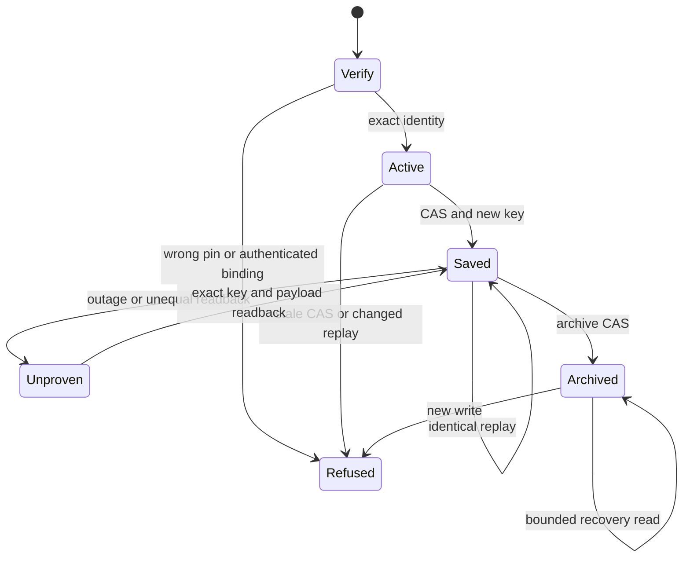
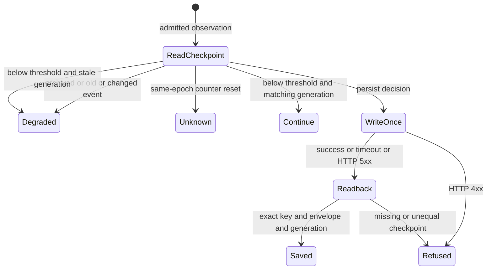

Card: WR826.S3.J2
System design before code. CARR owns scoped continuity records, not native task execution. The development bridge owns pin verification and delegates policy to the exact factory artifact. Native S4-S6 remain pending.
Data shape. An authenticated dedicated credential binds a sponsor, authority_session and exact factory binding. A versioned command carries expected_generation, stable idempotency_key, immutable binding and bounded envelope. The server derives sponsor and authority_session from its credential map, never arguments. The current checkpoint and eight exact replay receipts live in Postgres. Archive is terminal and retains custody.
Alternative A reused old provider tables and verbs. Rejected because their revision/event semantics were retired in migration 1050 and machinery reset. Alternative B uses one new scoped table with three neutral v1 verbs and a pinned development adapter. Chosen for independent auth and bounded state without reviving orchestration.
At current and 10x load each operation locks one session row. Storage and replay history are bounded per session; archive keeps the final checkpoint. No scans, global lock, cache, fanout or N+1. Postgres is the sole authority. Reads refuse missing or different identity; writes use CAS and exact replay comparison. Calls are sequential write/readback, no queue. One timeout, no write retry, one exact readback on ambiguous response. Failure refuses protection, with no local substitute or new key. Pin verification runs before any import or effect. No download or worker factory dependency.
Statechart, executable test model rather than formal proof.

Throughput checkpoint. One worker, contract first, bridge second, proof third. Shared tools.js registration is held by open PR 2972 and must serialize. No children. The proof runner will declare local synthetic support separately from future authenticated production write/readback obligation.

Implementation and limits. The current table stores one immutable credential binding, one current envelope and eight full replay receipts. A separate append-only key/hash ledger prevents changed-key-payload replay after full receipts expire. Ledger size grows with accepted writes, with constant indexed access and no hot global row. An expired exact replay refuses explicitly. Archive retains current checkpoint and immutable key history. Tests execute the real module against disposable PostgreSQL and the exact locally supplied factory artifact. CI without that artifact skips that additional bridge proof and never downloads it.

Transport has three requests maximum, zero write retries, an eight-second socket timeout and an eight-second elapsed read deadline. A slow read can exceed the deadline by one socket timeout, giving a maximum 48-second transport budget plus pin verification. No redirect forwards the credential. Missing pins, mismatches, outage, changed replay and unequal readback refuse protection. A below-threshold factory decision has no authority effect and makes no saved/protected claim. No native callback claim is made.

Source registration. J3 merges main after holder 2972, registers the neutral module at the ordinary tools.js seam and regenerates the operation registry. The dedicated credential has an exact three-operation profile at discovery, MCP execution and composite registered dispatch. Ordinary profile read permissions remain unchanged. The registered schema is frozen, so the module validates a private schema clone. No provider alias or factory runtime import is introduced. PostgreSQL tests cross the real MCP writer route with the actual carr_writer database login and compare its readback with the direct registered call. The transport pool and request budget use fixture adapters; no deployed endpoint is called.

CI accounting. Both new suites lacked measured entries and each inherited the 251409 ms conservative serial fallback. Hosted run 41895297349 measured session-checkpoints-auth.test.mjs at 805 ms and session-checkpoints.test.mjs at 1256 ms. The profile adds those observations and preserves cold setup, watchdog, headroom, discovery and exact coverage assertions. Source logs are retained with the J3 report.

Operational proof obligation. After ordinary delivery, the coordinator must bind exact CARR release, this adapter revision and every factory digest, provision the dedicated authority session through the supported credential path, and perform one authenticated synthetic checkpoint/readback through the supported v1 verbs. Verify server-derived sponsor/session, immutable native task ownership, exact generation, replay, archive custody and recovery output. The current admitted worker release smoke runner proves release identity only. It cannot execute or attest this write/readback. Operational proof remains separate and pending. S4-S6 native installation, callback ordering and recovery delivery remain pending.

J6 bridge comparison contract. Before returning an admitted below-threshold decision, the bridge reads the current authority checkpoint. Older epoch or cursor returns degraded old_replay. The same cursor with changed event fields returns degraded changed_replay. A fresh same-epoch, same-model, same-window counter decrease returns unknown counter_reset_without_new_epoch. These refusals never write or advance CARR. The factory excludes now and expected_generation from event identity; the bridge does too.

Parity is partial. The pinned factory Store durably advances observation metadata even below threshold without advancing generation. CARR v1 exposes checkpoint write, read and archive only. The bridge does not advance metadata on non-persist observations. Comparisons use the last durable checkpoint; resets or replays relative only to intervening non-persist observations cannot be detected. No new v1 operation is implied. Generation conflicts on below-threshold observations refuse explicitly. The bridge promises no saved receipt for those observations.

The selftest exercises counter resets, old and changed events, archive, below-threshold observations, CAS, outage, ambiguous timeout and HTTP 502. Transport tests use a stub opener with real urllib redirect handlers for cross-host 307 and 303. A deterministic slow-drip response advances a fake monotonic clock; the elapsed deadline raises TimeoutError. The opener assertion separately requires the eight-second socket timeout. These tests use no network or live credential. A write HTTP status at least 500 is ambiguous and gets one exact-key readback within the existing three-request budget. HTTP 4xx and read HTTP errors refuse immediately.
