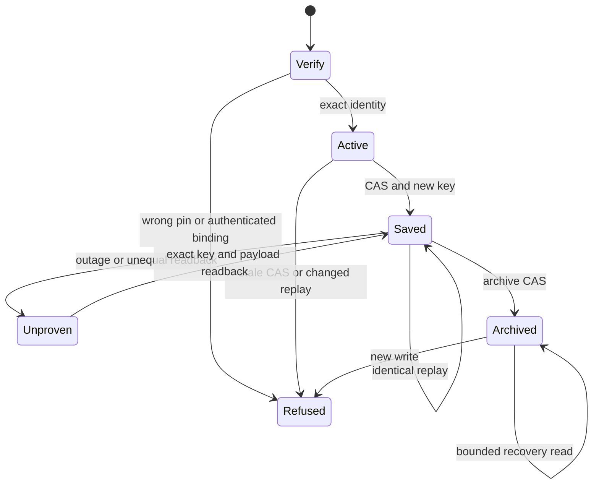

Card: WR826.S3.J2
System design before code. CARR owns scoped continuity records, not native task execution. The development bridge owns pin verification and delegates policy to the exact factory artifact. Native S4-S6 remain pending.
Data shape. An authenticated dedicated credential binds a sponsor, authority_session and exact factory binding. A versioned command carries expected_generation, stable idempotency_key, immutable binding and bounded envelope. The server derives sponsor and authority_session from its credential map, never arguments. The current checkpoint and eight exact replay receipts live in Postgres. Archive is terminal and retains custody.
Alternative A reused old provider tables and verbs. Rejected because their revision/event semantics were retired in migration 1050 and machinery reset. Alternative B uses one new scoped table with three neutral v1 verbs and a pinned development adapter. Chosen for independent auth and bounded state without reviving orchestration.
At current and 10x load each operation locks one session row. Storage and replay history are bounded per session; archive keeps the final checkpoint. No scans, global lock, cache, fanout or N+1. Postgres is the sole authority. Reads refuse missing or different identity; writes use CAS and exact replay comparison. Calls are sequential write/readback, no queue. One timeout, no write retry, one exact readback on ambiguous response. Failure refuses protection, with no local substitute or new key. Pin verification runs before any import or effect. No download or worker factory dependency.
Statechart, executable test model rather than formal proof.

Throughput checkpoint. One worker, contract first, bridge second, proof third. Shared tools.js registration is held by open PR 2972 and must serialize. No children. The proof runner will declare local synthetic support separately from future authenticated production write/readback obligation.

Implementation and limits. The current table stores one immutable credential binding, one current envelope and eight full replay receipts. A separate append-only key/hash ledger prevents changed-key-payload replay after full receipts expire. Ledger size grows with accepted writes, with constant indexed access and no hot global row. An expired exact replay refuses explicitly. Archive retains current checkpoint and immutable key history. Tests execute the real module against disposable PostgreSQL and the exact locally supplied factory artifact. CI without that artifact skips that additional bridge proof and never downloads it.

Transport has three requests maximum, zero write retries, an eight-second socket timeout and an eight-second elapsed read deadline. A slow read can exceed the deadline by one socket timeout, giving a maximum 48-second transport budget plus pin verification. No redirect forwards the credential. Missing pins, mismatches, outage, changed replay and unequal readback refuse protection. A below-threshold factory decision has no authority effect and makes no saved/protected claim. No native callback claim is made.

Source registration hold. The required import and registerTools call belong in tools.js. PR 2972 currently owns that path and this task expressly excludes edits there. No unrelated family or legacy provider module is used as a registration backdoor. The implementation is dormant until that holder merges and registration plus generated registry can be added to this same PR. This is a source coordination constraint, not a missing contract, permission request or deployed capability claim.

Operational proof obligation. After ordinary delivery, the coordinator must bind exact CARR release, this adapter revision and every factory digest, provision the dedicated authority session through the supported credential path, and perform one authenticated synthetic checkpoint/readback through the supported v1 verbs. Verify server-derived sponsor/session, immutable native task ownership, exact generation, replay, archive custody and recovery output. The current admitted worker release smoke runner proves release identity only. It cannot execute or attest this write/readback. Operational proof remains separate and pending. S4-S6 native installation, callback ordering and recovery delivery remain pending.
