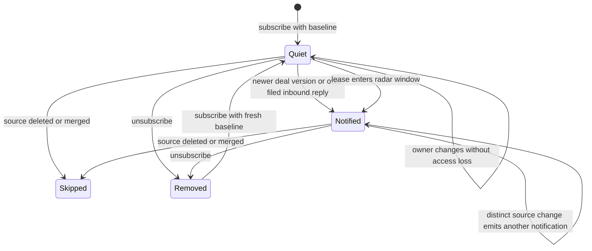
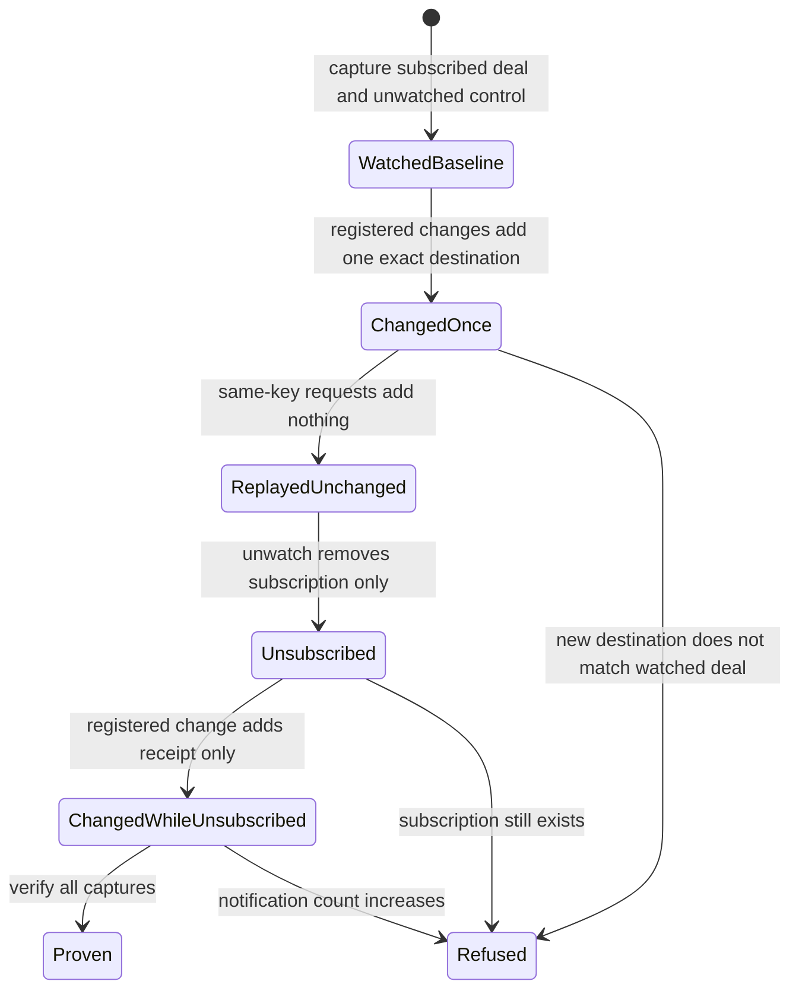

# System design

Card: WR617.S4.J3

Subscriptions and initial versions belong to `ops.subject_watch` at contract
3ea487f1c8944af6dc8bb7337c9ae3aac1d214bd. This consumer never edits them.
The consumer runs on the deployed `public.event` insert seam, alongside the
existing loop notification trigger. No daemon, external calls, credentials,
provider sends, or new public verb is needed.

Two designs were considered. A global event high-water mark can skip an event
whose transaction commits out of order. An insert trigger sees each committed
transition atomically, so it wins. Deal version changes and canonical inbound
filings target at most two partner subscriptions. Reply keys use the activity
identity, so filing retries cannot create another interruption. Generic deal
updates use the canonical deal version. Each notification uses the existing
`ops.mint_notification` writer, with a key containing the subscription UUID and
source identity. Reads and delivery acknowledgements never reset that key.

Lease clocks need bounded work even without an explicit lease edit. Each normal
event advances a durable UUID cursor through at most 50 lease subscriptions.
The radar's 24-month calendar policy becomes a shared function used by both
read projection and consumer. A lease crossing that window emits once per
subscription, canonical lease version, and recorded expiration date. Subscribing inside the window takes
a quiet baseline. A quiet database delays clock wakes until another event;
there is no promise of a wall-clock alarm. Batches continue on subsequent events.
At ten times the watches, clock latency grows by ten times until batch frequency
or size changes. Direct deal and reply delivery still has at most two recipients.

Consumer cursor, lease observations, and notifications commit with the source
event. A failed source lookup or notification operation aborts that transaction,
so retry cannot lose an event. Deleted or merged targets are skipped. Ownership
does not change a subscription: the contract permits both partners to watch the
same shared record. Mailbox-owned inbound replies notify only that mailbox's
watching partner. No personal email body enters the notification.

All new tables and functions are owner-only. Callers cannot name another actor
or drive a scan. Exact app destinations are `/deals?deal=<uuid>` and `/clients?record=<uuid>`,
using the existing business record routes. No cache or external circuit breaker
is needed. The indexed subscription scan and single-row source lookups bound
work. A scanner skips a busy lease cursor, so it never waits on another event transaction. The next event resumes the durable cursor. Notification uniqueness
is the durable delivery receipt. Tests cover the statechart transitions and the
shared radar policy before implementation.

# Statechart

Owner changes with a new deal version are ordinary deal transitions and notify.
The chart omits transaction failure loops: rollback retains the prior cursor and
notification set. PostgreSQL tests replay the paths; TLC checks the finite model in `Watch.tla`. The finite model abstracts source content and provider delivery. It reached 112 states and 516 steps with no invariant violation. The compact chart hides same-label steps, including acknowledgements, version changes, and scan progress. Reproduce with the installed statechart skill runner, `Watch.tla --view view.mjs --out /tmp/watch-model-fresh`.

# Throughput checkpoint

Verify real database transitions first, then MCP projection regressions, gates,
and the pre-push floor. Registration is unchanged, so this unit does not add a
registration dependency on PR 2974. The subscription contract has landed on main as `1154_subject_watches.sql`. This branch merges main and follows that contract with `1156_subject_watch_events.sql`.

# Delivery limits

The app routes were verified in `jbookout/doctorcre-app` source, `js/lease-radar.js`, which links clients with `record` and deals with `deal`. The notification check constraint now admits only those exact UUID query forms in addition to its existing paths. The replacement check is NOT VALID to avoid scanning historical notification rows; existing rows already satisfied the stricter old constraint.

The production requirement admits a read-only release smoke only. The registered smoke runner cannot execute a watched-record mutation. After deployment the coordinator must perform the requested live experiment, inspect the watching partner feed, and verify the unwatched control and rerun. No production completion is claimed here.

# Partner writer regression and scope rule

Card: WR617.S4.J12

The event's personal_scope records the writer's sponsor, not the confidentiality
of a canonical deal or lease. The consumer accepts none, joe-personal and
dell-personal inside carr-internal. Ordinary shared deal changes notify either
partner who subscribed. A Joe-attributed update-deal therefore wakes Dell when
Dell watches that deal. Inbound replies still require the activity's mailbox
owner to match the watching partner. The activity's content is never copied.
Other tenants remain excluded before receipts or lease scans.

The data shape remains an event identity, shared subject identity, subscription
identity and recipient. No new write interface, queue, cache or external call
is introduced. The fixed transition is Quiet to Notified on a registered human
or sponsored update-deal. The retained isolation transition is Quiet to Quiet
on another mailbox's reply even when its audit scope is joe-personal. Registered
writer regressions exercise Joe, Dell and Joe-sponsored Codex through carr_writer.
They also replay the registered write and event consumer. Existing event-ingress
tests retain the foreign-tenant and own-mailbox cases.

# Execute the production proof

The coordinator owns the live mutations and release observation. This worker
used disposable synthetic PostgreSQL only. Release smoke alone cannot establish
notification behavior. The supplemental verifier is
`ops/verify-subject-watch-proof.py`. It has no write mode or provider sends.
Each capture runs one repeatable-read transaction with a five-second SQL timeout,
returns two aggregate rows and saves only a selection hash, subscription presence, and counts.
The initial live selection must contain a watched, visible deal and an unwatched, visible
control for the same partner. Merged clients and deleted or merged parties fail
selection. Keep these records otherwise quiet during the experiment. Concurrent
changes fail closed through unexpected count deltas. Use a configured libpq
service with read access to the watch, event, notification and receipt tables.
Never place a live connection string in a command or artifact.

The coordinator runs all of these steps after release identity matches.

1. Select the live watched and unwatched deal UUIDs for one partner.
2. Run `python ops/verify-subject-watch-proof.py capture` with those `--watched`, `--unwatched`, and `--actor` values and `--output /tmp/watch-before.json`.
3. Execute one registered update-deal per selected deal, changing one field each, and retain each exact idempotency key and request.
4. Capture the same selection to `/tmp/watch-after.json`.
5. Replay both original registered requests with their original idempotency keys.
6. Capture the same selection to `/tmp/watch-replay.json`.
7. Execute registered unwatch-subject-v1 for the watched deal and the selected partner.
8. Capture the same selection to `/tmp/watch-removed.json`.
9. Execute a distinct registered update-deal on that deal with its current version and a fresh idempotency key.
10. Capture the same selection to `/tmp/watch-suppressed.json`.
11. Run `python ops/verify-subject-watch-proof.py verify --before /tmp/watch-before.json --after /tmp/watch-after.json --replay /tmp/watch-replay.json --removed /tmp/watch-removed.json --suppressed /tmp/watch-suppressed.json`.

The final command must return zero and report watched 1, unwatched 0, replay 0,
and suppressed 0. Each initial change adds one receipt. Replay adds neither
receipts nor notifications. The watched change adds one notification with exactly
`/deals?deal=<watched UUID>`. Unwatch changes only subscription presence. The
post-unwatch change adds one receipt and zero notifications. A missing source,
wrong destination, wrong subscription state, zero watched wake, duplicate wake,
or changed control fails. The PostgreSQL suite executes the exact CLI against
registered Joe, Dell and sponsored writer paths. It injects wrong destinations
at notification insertion and verifies refusal. Production observation remains
coordinator-owned and has not run in this worker.

# Cursor contention regression

Admitting real human events exposed a lock cycle in unrelated registered record
writes. The prior blocking singleton cursor serialized every event transaction,
including one holding vendor locks while another needed them. The migration
acceptance relationship suite failed its verification-first ordering case.
Removing the trigger in a disposable control made all 13 relationship tests pass;
replacing the blocking cursor lock with SKIP LOCKED also made all 13 pass.
The watch regression now holds the scan cursor on a second connection while a
registered update-deal commits. It failed first with SQLSTATE 57014 at the cursor
lock. A busy scanner now returns zero without moving the cursor. A later event
retries lease scanning from that durable cursor, while direct deal notifications
remain in the source transaction. Existing bounded-batch and rollback tests
prove later scans neither skip leases nor commit failed progress.

# Proof verifier correction

Card: WR617.S4.J16

This is a bounded one-session correction to proof observation, not a consumer
redesign. The read-only capture owns a selection hash, subscription presence,
and three counts per deal: notifications, event receipts, and notifications
whose destination equals `/deals?deal=<selected UUID>`. The verifier owns the
five-snapshot sequence. The consumer and notification storage retain ownership
of all writes.

Two interfaces were considered. Exporting notification IDs and destinations
would let the verifier inspect individual rows. Computing exact-destination
counts in the same repeatable-read SQL statement preserves aggregate artifacts
and avoids a second read or per-notification query. Choose the latter. Existing
wrong destinations do not invalidate a fresh experiment; the new notification
must increase the exact-destination count by one.

The proof states are Watched baseline, Changed once, Replayed unchanged,
Unsubscribed, and Changed while unsubscribed. Capture records subscription
presence instead of requiring it throughout the experiment. Verification
requires it in the first three samples and refuses it in the final two.
Unsubscribe must leave counts unchanged. The subsequent registered change must
add one receipt and zero notifications. All five samples bind the same selection.
Concurrent changes fail the expected deltas. Schema-invalid old count-only
artifacts fail closed rather than retain a compatibility mode.

Capture still uses one two-record query with indexed subqueries, one repeatable
read transaction, and a five-second timeout. At 10x retained notifications the
aggregate lookup is the first growing cost; no new N+1 query, fan-out, cache,
queue, external call, circuit breaker, or write idempotency key is introduced.
SQL or file failures refuse the proof. Source writes remain separately authorized
registered requests with retained idempotency keys. Five bounded captures replace
three. Release observation remains in the existing registered release runner,
so this supplemental CLI does not read `/release`.

Throughput checkpoint: reproduce both proof gaps on the existing registered
writer fixture, commit the failing tests, fix the capture and verifier, then run
focused acceptance and strict CI. No new suite needs a duration entry.

The proof sequence is executable PostgreSQL acceptance, not a new TLC claim.
The original finite model does not model source merges, deletion, resubscription,
or actor isolation. The checked-in database tests exercise these cases.

The supplemental read-only verifier lives in `ops/` alongside other production
proof runners. The current delivery inventory reserves `tools/` for installed
Studio runtime. This verifier does not install or operate a Studio service.
