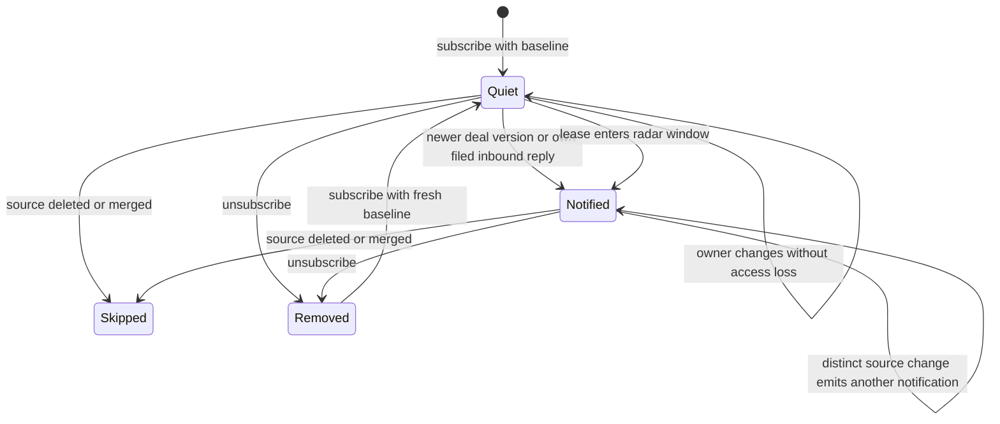

# System design

Card: WR617.S4.J3

Subscriptions and initial versions belong to `ops.subject_watch` at contract
3ea487f1c8944af6dc8bb7337c9ae3aac1d214bd. This consumer never edits them.
The consumer runs on the deployed `public.event` insert seam, alongside the
existing loop notification trigger. No daemon, external calls, credentials,
provider sends, or new public verb is needed.

Two designs were considered. A global event high-water mark can skip an event
whose transaction commits out of order. An insert trigger sees each committed
transition atomically, so it wins. Deal version changes and canonical inbound
filings target at most two partner subscriptions. Reply keys use the activity
identity, so filing retries cannot create another interruption. Generic deal
updates use the canonical deal version. Each notification uses the existing
`ops.mint_notification` writer, with a key containing the subscription UUID and
source identity. Reads and delivery acknowledgements never reset that key.

Lease clocks need bounded work even without an explicit lease edit. Each normal
event advances a durable UUID cursor through at most 50 lease subscriptions.
The radar's 24-month calendar policy becomes a shared function used by both
read projection and consumer. A lease crossing that window emits once per
subscription, canonical lease version, and recorded expiration date. Subscribing inside the window takes
a quiet baseline. A quiet database delays clock wakes until another event;
there is no promise of a wall-clock alarm. Batches continue on subsequent events.
At ten times the watches, clock latency grows by ten times until batch frequency
or size changes. Direct deal and reply delivery still has at most two recipients.

Consumer cursor, lease observations, and notifications commit with the source
event. A failed source lookup or notification operation aborts that transaction,
so retry cannot lose an event. Deleted or merged targets are skipped. Ownership
does not change a subscription: the contract permits both partners to watch the
same shared record. Mailbox-owned inbound replies notify only that mailbox's
watching partner. No personal email body enters the notification.

All new tables and functions are owner-only. Callers cannot name another actor
or drive a scan. Exact app destinations are `/deals?deal=<uuid>` and `/clients?record=<uuid>`,
using the existing business record routes. No cache or external circuit breaker
is needed. The indexed subscription scan and single-row source lookups bound
work. Lease cursor updates serialize concurrent batches. Notification uniqueness
is the durable delivery receipt. Tests cover the statechart transitions and the
shared radar policy before implementation.

# Statechart

Owner changes with a new deal version are ordinary deal transitions and notify.
The chart omits transaction failure loops: rollback retains the prior cursor and
notification set. PostgreSQL tests replay the paths; TLC checks the finite model in `Watch.tla`. The finite model abstracts source content and provider delivery. It reached 112 states and 516 steps with no invariant violation. The compact chart hides same-label steps, including acknowledgements, version changes, and scan progress. Reproduce with the installed statechart skill runner, `Watch.tla --view view.mjs --out /tmp/watch-model-fresh`.

# Throughput checkpoint

Verify real database transitions first, then MCP projection regressions, gates,
and the pre-push floor. Registration is unchanged, so this unit does not add a
registration dependency on PR 2974. The subscription contract has landed on main as `1154_subject_watches.sql`. This branch merges main and follows that contract with `1156_subject_watch_events.sql`.

# Delivery limits

The app routes were verified in `jbookout/doctorcre-app` source, `js/lease-radar.js`, which links clients with `record` and deals with `deal`. The notification check constraint now admits only those exact UUID query forms in addition to its existing paths. The replacement check is NOT VALID to avoid scanning historical notification rows; existing rows already satisfied the stricter old constraint.

The production requirement admits a read-only release smoke only. The registered smoke runner cannot execute a watched-record mutation. After deployment the coordinator must perform the requested live experiment, inspect the watching partner feed, and verify the unwatched control and rerun. No production completion is claimed here.
