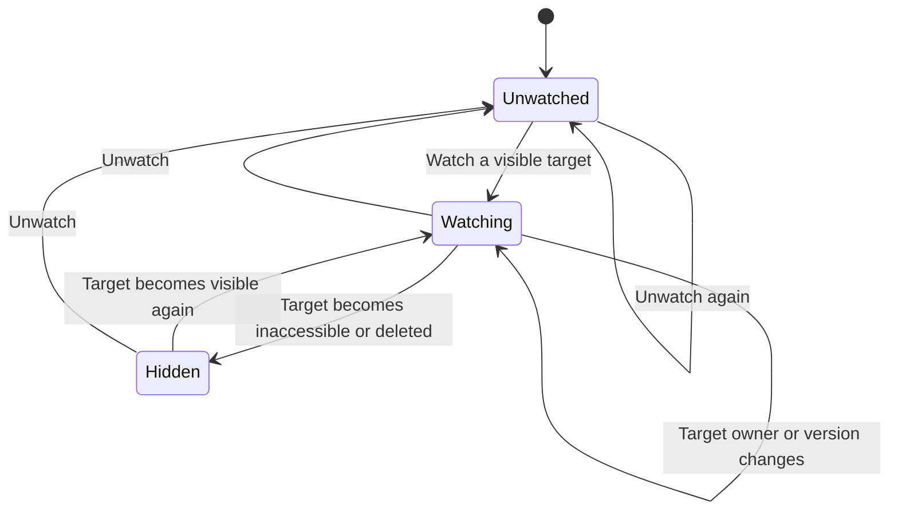

# Partner watches

Sizing is one bounded session with one migration and one registered verb family.

## Ground and sketch

CARR owns records and authentication. Deal Room uses v_deal_room_deal for both partners regardless of owner. Lease radar joins unmerged clients and undeleted parties. The watch stores the authenticated partner's subscription and initial target version. Existing notification preference and minting functions retain delivery authority. Subscription never produces a notification.

The source census found no listing record contract. evaluateRepresentationScope refuses listing-side activation. Listing watch acceptance is blocked on canonical identity and visibility, rather than inventing a record.

Consumers call watch-subject-v1, unwatch-subject-v1, read-subject-watch-v1 and list-subject-watches-v1. Writes take a subject type, UUID and idempotency key. Reads have no actor argument. Responses use subject-watch.v1.

Alternative A uses per-kind tables and verbs, repeating actor and replay policy. Alternative B uses one actor-target keyed table and a target-facts SQL seam. Choose B for a small interface and centralized visibility. No event engine belongs here.

## System design

Architecture. The registered module validates and uses the shared audited envelope. Security-definer SQL resolves server-established actor context and canonical target visibility. Postgres owns baseline and subscription state.

Capacity and scaling. Current and 10x partner load use indexed point writes and 100-row keyset pages. Postgres query cost breaks first. Stateless Workers share the database. Visibility joins execute in one query per page, without an application N+1 loop.

Load spread. Actor-target primary keys separate subscriptions. Transaction advisory locks serialize replay before reading receipts. The unique primary key serializes first subscriptions.

Caching. None. Reads recheck visibility. Baselines persist until unwatch and a fresh watch.

Availability and consistency. Database failure rolls back state and audit receipts together. Access loss refuses even exact replay. Reassignment preserves the subscriber because Deal Room visibility is shared. Deleted or merged client parties hide targets. Unwatch remains allowed after access loss to remove stale subscriptions.

Async. None. A later producer compares baseline version with current facts and uses existing notification policy. Subscribe emits neither notification nor business activity.

External calls and circuit breakers. None beyond the existing request database transaction. No retry or external fallback is introduced.

Rate limits. Lists read at most 101 rows and return at most 100 with a cursor. No fan-out or external API loop.

Idempotency. UUID keys bind actor, verb and payload through the shared envelope. Changed payload or principal refuses key_reuse. Rewatch preserves baseline. Resubscribe after unwatch captures a fresh baseline.

## Statechart written before implementation

Changed payload refuses without transition. Each partner has independent state. Unknown targets refuse initial watch and single-target read. Lists omit inaccessible targets. No transition emits a notification. Tests call executeRegisteredTool with restricted database roles.

## Throughput checkpoint

1. Blocking first steps are identity census, overlap census, design and failing tests.
2. Independent workstreams stay with this worker because the brief forbids subagents.
3. Shared state separates by actor-target primary key and serializes by transaction locks.
4. One worker owns the coupled migration, registered contract and acceptance suite.

## Design and debt pass

codebase-design centralizes visibility and baseline identity in one target-facts seam. Tests use the registered public interface.

zero-tech-debt adds no compatibility aliases, guessed listing records or duplicate notification policy. Positive net lines introduce subscriptions with no predecessor to delete.
