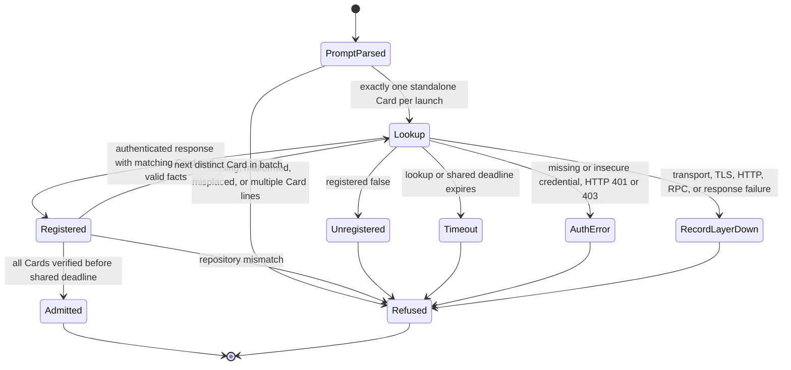

# Card admission

Every refusal starts no work. No prior mint or admission can admit offline.
Each lookup has a three-second hard deadline within an eight-second batch
budget and the host's ten-second hook timeout. Repository discovery retains
its half-second bound. A late success refuses.

Tests derive from each edge through the hook JSON stdin entry point. The
existing prompt, Codex, and T3 tests pin parsing and excluded tools. The direct
transport matrix covers registration, response facts, authentication, outage,
and TLS. Deadline tests cover DNS, TLS, headers, trickling bodies, late success,
and shared batch exhaustion. Repository tests cover mismatch, null, worktrees,
and inherited Git environment isolation. Excluded read-only tools do not enter
this chart. The model omits provider execution after admission.
