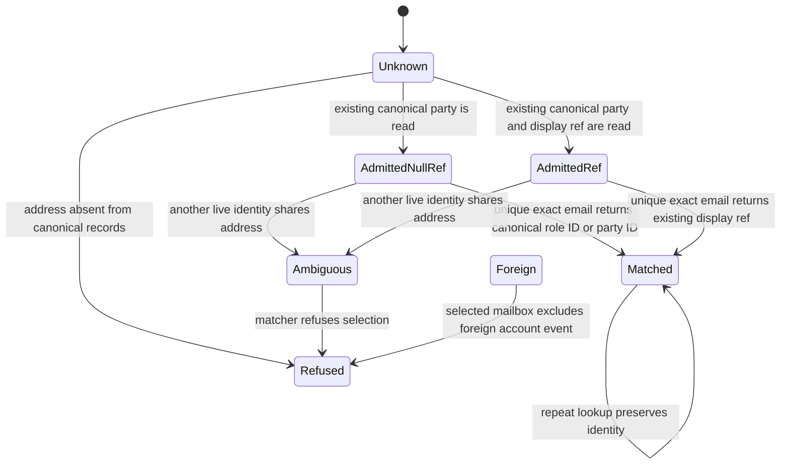

# Calendar contact lookup

Data shape is a live canonical party, zero or more role records, stored nullable display refs, and exact email candidates. Lookup reads existing identities only.

Unknown means no stored identity. Lookup never creates a party or role. Deleted and merged parties cannot establish a match. Shared inboxes and multiple distinct identities remain unresolved. Foreign mailbox evidence remains governed by the existing account-bound intake loader; the contact directory is the existing single internal CARR tenant, not a caller-selected tenant. No new tenancy model is introduced.

System design. The registered find and email-match-contacts handlers own projection of existing record identities. PostgreSQL owns canonical IDs. Intake owns mailbox binding and exact-match uniqueness. Compare minting display refs with using existing IDs. Choose existing IDs to avoid writes, schema changes, and fabricated identities. Existing display refs retain priority. An admitted role without its display ref uses its role ID, never an unrelated party or deal ID.

Capacity and access. One existing set query projects contacts; no additional round trips or N+1. At 10x directory size result size remains the existing limiting factor. No new fan-out, cache, queue, write, idempotency key, or external call. Failure of PostgreSQL refuses the read through the existing handler. No stale cache or new fallback. Account selection and authentication remain upstream. No circuit breaker or rate-limit loop is added because there is no new external call or retry.

Proof maps. The calendar PostgreSQL regression exercises four null-ref parties, three null-ref roles, an existing ref, repeated lookup, unknown address, shared address, deleted/merged parties, registered UUID resolution, and the real Python intake matcher. Existing account isolation tests exercise Foreign. Production still requires observing the four actual admitted contacts in the installed intake after deployment.
