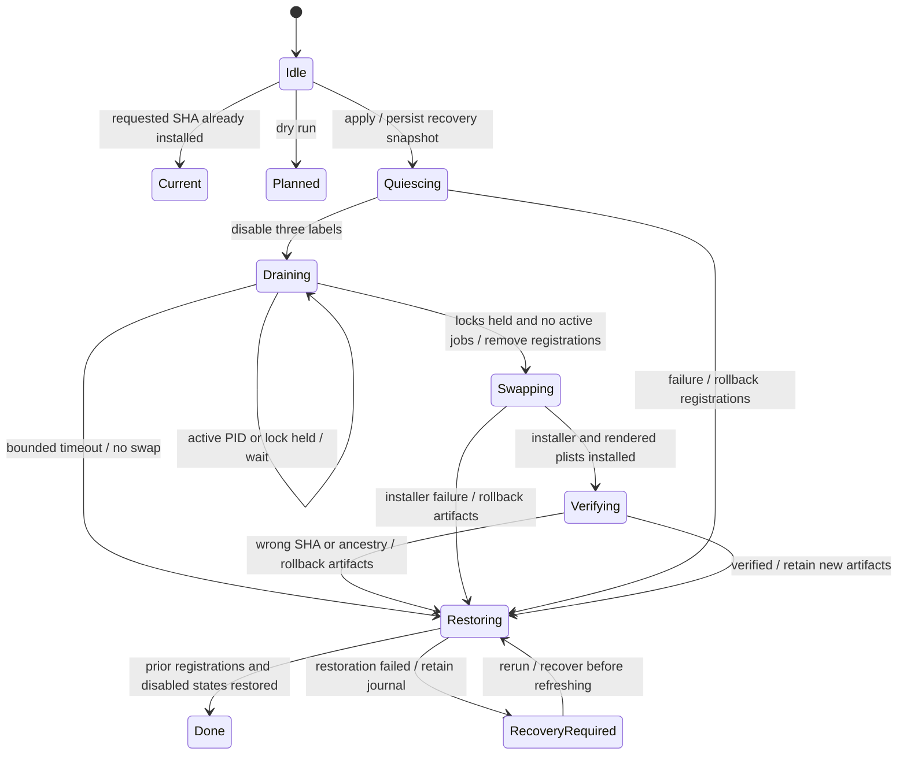

# Outlook runtime refresh

Invariants. Never bootout until the send and outbox locks are held and observed jobs are idle. Never swap before all three registrations are removed. Hold locks through verification and restoration. A timeout never changes runtime artifacts. Dry run and already-current do not mutate. Restoration errors preserve the recovery snapshot for rerun. No kickstart, signal or process termination command is issued.

The model covers process failures and reruns. It excludes simultaneous manual installers, manual starts outside launchd and system power loss during filesystem restoration. Launchd can race the idle observation; held send/outbox locks fence that race from dispatch. A raced invocation can be removed only before it can acquire its write lock.

TLC checked the abstract drain invariants across 18 states and 24 steps. Both
`NoSendInterrupted` and `SwapDrained` held, with no deadlocks. The abstract model
omits artifact copying, installer internals and recovery failures; the transition
and filesystem tests cover those separately. Regenerate with pstack's
`statechart/scripts/statechart Refresh.tla --out /tmp/outlook-refresh-model` from
this fixture directory, with Java 11+ and `TLA2TOOLS` pointing at tla2tools.jar.
