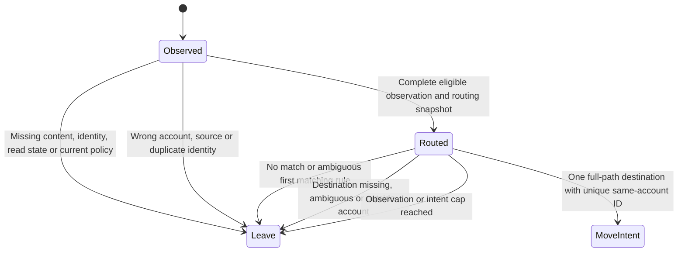

# Deterministic triage planner fixtures

All identities, content, paths and relationships here are synthetic. Run
`python3 ops/outlook-triage-plan-selftest.py` from the repository root.

`routing.json` supplies the existing folder-guide format and snapshots of the
`find` verb's parties and deals. The planner reuses `RULES` from
`lib/outlook_triage.py`. It never invokes `CarrFinder`, reads a mailbox, or moves
mail. The existing UI triage remains unchanged until the executor slice.

`RoutingContext.from_find_results` freezes the rule inputs. The caller supplies
an explicit completeness assertion. The `find` verb returns fuzzy, capped
results, so absence of another match cannot establish completeness. Missing
queries and uncertified snapshots cause a hold. The caller must establish
snapshot completeness and current policy version before planning. This slice
adds no routing acquisition or batch record-layer verb.

`plan_triage(observations, routing_context, folder_catalog, policy)` returns
immutable move intents and leave decisions. Observations contain complete
content for eligibility checks. Results retain only message references and
fixed reasons. A reference binds account, message ID, revision, source folder,
read state, observation timestamp, snapshot digest and decoder pin. An intent
also binds destination identity and full path, routing and catalog versions,
and the read-policy parameter. These are private planning data, not log output.
A future executor must enforce current identity and policy preconditions.

The default `require_read_before_move=True` holds unread messages. Setting it
to false admits known unread messages only. Unknown read state and incomplete
content remain holds under both policies. No production read-policy decision
is made here.

## Planning decisions

This is stateless evaluation, not a persistent workflow or a model-checked
executor. Tests exercise every decision above, including each rule's ambiguity
and precedence, legacy name and client-ref relationships, and a 1,500-message
batch. The first 1,000 observations are considered for routing and at most 150
intents are returned by default. All remaining observations receive leave
codes. Input and output storage grow linearly with the supplied batch; there
is no I/O or external fan-out. Input order determines priority under caps.

PRODUCTION PROOF: none until the executor slice; this slice is proven by fixtures only.
