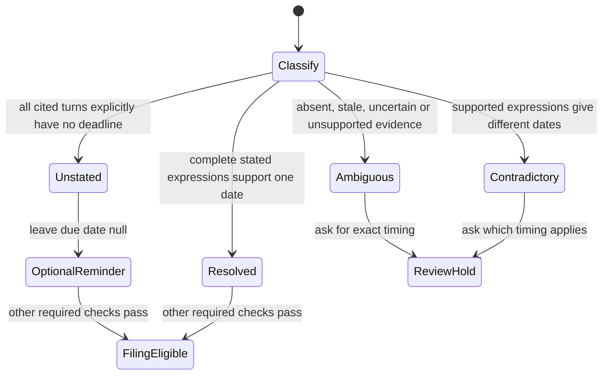

# Post-call deadline states

Every transition is exercised by `test_timing_cases_control_filing_and_retention`,
which runs the committed offline corpus through process_session, real coverage
reconciliation, review_complete and retention_ready. `test_timing_evidence_integrity`
exercises missing, omitted, stale and misattributed source evidence.
No TLC execution is claimed. The model covers deadline validation; identity,
audio, candidate confirmation and required-check holds remain independent gates.

Semantic timing classification is model output. Each source entry explicitly
judges a complete cited speaker turn, rather than only the short task quote.
`unstated` requires every entry to say unstated and contain no expressions.
`uncertain` never becomes an optional reminder. Corrections and alternatives must
remain in the complete expression; unsupported expressions hold review.
The deterministic date grammar matches whole expressions, never an extracted
weekday inside an unsupported expression. Distinct supported dates contradict.
