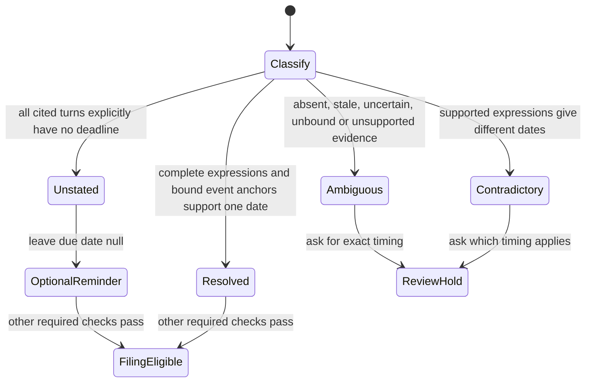

# Post-call deadline states

Every transition is exercised by `test_timing_cases_control_filing_and_retention`,
which runs the committed offline corpus through process_session, real coverage
reconciliation, review_complete and retention_ready. `test_timing_evidence_integrity`
exercises missing, omitted, stale and misattributed source evidence.
No TLC execution is claimed. The model covers deadline validation; identity,
audio, candidate confirmation and required-check holds remain independent gates.

Semantic timing classification is model output. Each source entry explicitly
judges a complete cited speaker turn, rather than only the short task quote.
`unstated` requires every entry to say unstated and contain no expressions.
`uncertain` never becomes an optional reminder. Corrections and alternatives must
remain in the complete expression; unsupported expressions hold review.
The deterministic date grammar matches whole expressions, never an extracted
weekday inside an unsupported expression. Distinct supported dates contradict.

Dated event sources name their exact event-reference expressions in `anchor_for`.
The anchor date passes the same whole-expression validator as direct deadlines.
No sentence prefix selects an anchor. An unbound reference accompanied by other
stated timing holds rather than assuming the call day. A sole lunch-call reference
retains the existing call-day default. Multiple distinct or unsupported anchor dates
hold; repeated anchors supporting the same date resolve.

`test_timing_cases_control_filing_and_retention` covers the resolved and held
paths with `event_the`, `event_our`, `event_paraphrase`, `event_unbound`,
`event_uncertain`, `event_multiple` and `event_same_date`.
`test_event_anchor_binding_requires_cited_date` checks malformed, unrelated,
missing and uncited bindings. All earlier transition tests remain required.
