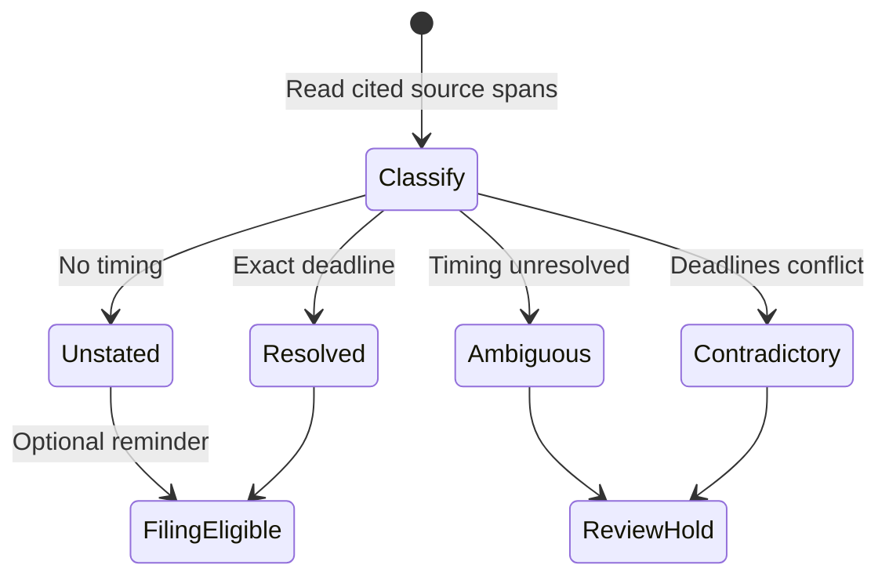

# Deal Room post-call workflow

Status: Call Mode foundation implemented; extraction, report review, and Outlook
draft approval remain a separate release.

## Outcome

After Joe and Dell's weekly deal call, the Deal Room should show one review pack:

- deal-by-deal status and proposed record changes;
- Joe's actions and Dell's actions for the week;
- what each attached client, vendor, or other participant needs to know;
- one proposed email per allowed recipient, created in Outlook Drafts only after
  a human approves it;
- unresolved references that need a person to identify the deal or recipient.

Nothing sends automatically. Nothing changes the record layer until Joe or Dell
confirms it.

## Safe data flow

1. Call Mode starts the existing Quill recorder after the operator confirms that
   everyone has been told the call will be recorded.
2. Quill records separate microphone and system-audio channels, announces the
   recording, and transcribes locally.
3. The authenticated Deal Room supplies a short-lived exact index of open deal
   IDs and each deal's current participant IDs, roles, names, and allowed email
   addresses to the loopback Call Mode service.
4. A no-tools local model receives only the local transcript and that exact
   index. Its strict JSON output may reference only IDs in the index. Ambiguous
   references become review questions, never guessed writes. The default
   model is the resident Flash Next server (Qwen3.8 Flash Next, already
   running on loopback for the Model Room flash desk; this workflow only ever
   calls it and never starts, stops, or restarts it). When that server is
   unreachable, the session is marked blocked with a plain reason ("Flash
   Next ... is not running") and can be retried; there is no fallback to the
   bundled Qwen2.5 1.5B model, which looped and never produced a pack
   (2026-09-23).
5. A deterministic validator rejects invented IDs, recipients not attached to
   the deal, unsupported phase values, oversized evidence, and malformed tasks
   or drafts.
6. The validator writes a mode-0600 local review pack. Only sanitized phase,
   next-step, activity, and meeting proposals enter the existing capture queue.
   Raw transcript and full email bodies stay local.
7. The Deal Room renders the local report and email-draft cards. Approving an
   email card calls the loopback service, which invokes `bin/outlook-draft.py`.
   That helper has no send path.
8. Audio and transcript become purge-eligible only after every proposal is
   dispositioned and a session-level aggregate report is confirmed.

## Required contracts for the next release

### Exact call index

The browser builds this from the existing board and deal-detail reads. Each
entry contains an immutable deal ID, display name, and current participants.
The local validator treats this as the entire allowlist for attribution and
recipient selection.

### Local review pack

The pack has these top-level sections:

- `deal_updates`: exact deal ID, summary, proposed phase/next-step/activity, and
  confidence/evidence;
- `assigned_actions`: exact owner (`joe` or `dell`), exact deal ID, action, and
  due date when stated;
- `external_drafts`: exact deal and participant IDs, recipient email from the
  index, subject, body, and why the recipient needs the update;
- `unresolved`: the source reference and the question a human must answer;
- `call_summary`: an attributed aggregate narrative that replaces the raw call.

### Pending follow-ups for Home

`read-post-call-followups` accepts `{}` and returns `post-call-followups.v1`
with `candidates` and `send: false`. Each candidate has `id`, `session_id`,
`deal_id`, `deal_name`, `kind`, `payload`, `evidence_quote`, and `created_at`.
Each candidate also has `source_call_started_at`, the exact source session's
start timestamp as an ISO 8601 string with an offset, and `source_call_label_key`,
the source session UUID as a string. The label key equals `session_id` and stays
stable as other calls arrive or leave the queue. Different sessions have distinct
keys even when their start timestamps match. The app can format the source time
for a call label and use the key to disambiguate collisions. It is metadata, not
a human-facing call title. `created_at` remains the proposal creation timestamp.
These fields are additive to `post-call-followups.v1`. Neither outcome review nor
the source call's age removes provenance from an otherwise eligible candidate.
Task payloads contain `deal_id`, `assignee`, `action`, and `due_on`.
Due dates come only from what was said on the call. Task timing is classified
from all complete source spans of the cited ledger facts, before the short
remote evidence quote is trimmed. The states are `unstated`, `resolved`,
`ambiguous`, and `contradictory`.

- `unstated` keeps `due_on` null and `due_defaulted: true`. Only this state adds
  an optional date reminder in `optional_reminders`, which does not block retention.
- `resolved` keeps the stated calendar date or the deterministic relative date.
  An unqualified weekday uses the upcoming occurrence under the existing call-date rule.
- `ambiguous` keeps `due_on` null and creates a blocking review question. This
  includes qualified timing such as "end of next week" or "sometime next month",
  and a calendar deadline present in the source but missing from `due_on`.
- `contradictory` keeps `due_on` null and creates a blocking review question for
  conflicting calendar or relative deadlines.

No date is invented. Undated tasks remain proposals, just like explicitly dated tasks.
The filing and retention predicates stay unchanged. Existing report holds are preserved.

One extraction writes each owner's task once: tasks on the same deal whose
titles match after case and whitespace normalization merge, a stated date
winning over none; two different stated dates stay separate proposals.
Email payloads contain `deal_id`, `recipient_party_id`, `recipient_ref`,
`subject`, and `body_sha256`. Email bodies and session tokens are excluded.

The read includes pending proposals for current active board deals from
unexpired post-call sessions at the distilling stage. It covers both partners
and both workspaces, orders by creation time and ID, and refuses above 1,000
candidates with `post_call_followups_limit_exceeded`. It uses the existing
writer grants inside a read-only transaction. No migration is required.

Use the existing `resolve-post-call-candidate` for a human decision. Email
confirmation records metadata only. Outlook draft creation still needs the
local report and companion. The aggregate filing report cannot gate this read
because filing requires all candidates to have a disposition. Home controls
remain a separate app change after this server contract is live.

### Human gates

- Record changes: existing capture candidate confirmation, except the
  automatic changes below.
- Joe/Dell assignment: explicit owner-aware action confirmation.

### Automatic changes from the weekly call (WR-000433 AC4, added 2026-10-26)

Joe's ruling, 2026-10-26: "the approval cards are probably good for
non-obvious decisions ... But a summary of the changes it applied
automatically would still need to be recorded and presented just in case they
were wrong".

- A deal's next step (with a stated date) and phase move (with a stated start
  date, when given) apply without a confirm when the distiller leaves
  `needs_review` null, the evidence quote appears word for word in the
  transcript, the call stated only one version of that change, and Jev's
  RIGHT DEAL check did not pick another deal. Everything else stays a card
  with its reason.
- The capture bridge applies each one right after filing, through
  `resolve-candidate` with `automatic: true`, as the recording partner's own
  local identity (`tools/call-verb.py`, joe-local or dell-local). It is
  base-guarded and audited like a Deal Room confirm; a refusal leaves a card.
- `read-call-outcomes` returns each unreviewed call: the applied changes with
  their evidence quote and the deal's current version, and the cards still
  open. `undo-call-change` reverts one applied change (base_version-guarded;
  refused once the card changed again). `review-call-outcome` takes the call
  off Home.
- Tasks, email drafts and anything outbound never apply automatically.
- External draft: explicit per-draft approval before Outlook Draft creation.
- Send: always performed by a human in Outlook.

### Retention gate

The current `ingested.json` marker is insufficient for a multi-deal call because
one confirmed meeting activity can create it while other candidates are still
pending. The next release must require both `pending == 0` and a confirmed
session-level aggregate report before writing the purge marker.

## Jev checks (added 2026-09-23, decision 008d682a)

Before Joe or Dell ever sees a draft item, `tools/dictation-rig/bin/post_call_jev.py`
runs it past Jev (TypeSafe) for three checks, right after `normalize_distillation`
and before the report is written:

- **RIGHT DEAL**: which recorded deal the item's words actually match, chosen
  from the item's own deal plus a handful of plausible alternatives (never
  the whole recorded-deal list);
- **RIGHT SPEAKER**: whether the item's attribution matches who actually said
  it — for `joe_tasks`/`dell_tasks` specifically, whether Joe or Dell said it;
- **RIGHT DETAILS**: whether the quoted evidence excerpt supports the item's
  specifics.

Each item in `joe_tasks`, `dell_tasks`, `deal_updates`, and `draft_proposals`
gets one `checks` object: `{deal, speaker, details, flagged, reasons}`. A
failed check **flags** the item with plain-English reasons in the review
pack; it is never silently dropped or held back from Joe or Dell. This is
purely a visible signal ahead of the human approval gates above — it does not
add, remove, or change any of them.

If Jev is unavailable (no local key, a network error, or any other failure),
the whole pack still ships: every affected item's `checks` becomes
`{"unavailable": true}` and one `review_questions` entry says the automatic
checks did not run. A Jev failure can never block or delay the review pack.

**Privacy change**: this is the first place post-call processing makes an
outbound network call. A short quoted evidence excerpt per item, the handful
of transcript segments nearest that excerpt (with their speaker labels), and
a short list of candidate deal names go to TypeSafe (`api.typesafe.ai`) for
this check. The full transcript, the full recorded-deal list, and email
bodies are never sent. The classifier calls the official TypeSafe SDK directly,
with all item questions in one request. The local process supplies
`TYPESAFE_API_KEY` through its environment.

## Non-goals

- biometric voice recognition or retained third-party voiceprints;
- fuzzy deal or recipient assignment when an exact ID is unavailable;
- storing raw transcript or full draft bodies in the capture Worker;
- automatic external sending;
- a second audio recorder or transcription engine.

### Post-call reliability

Accepting the same step for the same deal and owner merges into its oldest open
action, including actions entered outside Call Mode. Matching ignores case and
repeated whitespace; it does not infer paraphrases. Confirmation combines
evidence bullets and never changes the owner. It replaces the existing due date
only when the incoming date is stated (`due_defaulted: false`) and nonempty.
Defaulted, missing, and historical dates with unknown provenance preserve the
existing date. Closed actions remain history.

`read-call-outcomes` task cards at `calls[].open_cards[]` add
`existing_action_comparison`. Other proposal kinds omit the field. The outer
response version stays unchanged. The comparison is a current read, not a
reservation. A read failure fails the request; clients must show comparison
unavailable rather than infer no match from a missing field.

The comparison has `schema_version: "post-call-action-comparison.v2"` and
`status` of `exact_match`, `related_open_tasks`, `no_match`, or
`assignee_unavailable`. `exact_match` is an action snapshot or null.
`related_open_tasks` is an array of advisory open action snapshots. Each snapshot has
`id`, `source` (`next_action` or `capture_post_call_action`), `owner` (actor slug),
`description`, `status`, and `due_on` (ISO date or null).

An exact match previews merging the proposal's evidence into that action.
`date_effect` gives `current_due_on`, `proposed_due_on`, `resulting_due_on`,
`changes_due_on`, and `reason` (`stated_date`, `defaulted_date`, or
`unstated_date`). It is null without an exact match. An unknown date provenance
uses `defaulted_date` and preserves the current date. Exact eligibility and
oldest-action selection use the same matcher as acceptance. Legacy Call Mode
actions without a structured title cannot be exact matches.

Without an exact match and with a known assignee, the comparison returns up to five
open actions on the same deal, newest first, under `related_open_tasks`.
`related_open_task_total` is the total number of open actions on the deal. It is
null for exact matches and unavailable assignees. The app labels this list "Other open tasks on
this deal". It includes different owners and legacy unstructured actions,
regardless of wording. It excludes completed and dropped history. No lexical
similarity or possible-duplicate claim is made. For example, "Call the landlord
about HVAC" can show an open "Call the broker about HVAC" as ordinary deal
context. `no_match` means no exact eligible action and no other open tasks were
found, not that a proposed task is absent from deal history. The array is empty
for exact matches and unavailable assignees. Version 2 replaces the unshipped
version 1 `possible_match` status and `possible_matches` array. Clients must
render unsupported versions as comparison unavailable.

Context never merges or reopens work. Acceptance still locks the deal and
selected action and compares again, because actions may change after the
preview. The app's Before panel consumes this field in a separate delivery.

Extraction, context-fetch failures, and bridge synchronization each stop after
three failed attempts, with five and fifteen minutes between attempts. The local
session then shows `needs_attention`; recordings remain retained. Successful
synchronization before exhaustion clears its temporary failure state. Pending
human proposals do not consume synchronization attempts.

Deals excluded from active context, including IDs refused after the board read,
remain inspectable in the local report at `diagnostics.skipped_deals`, with
each distinct ID and reason counted once. Routine exclusions do not create human
questions. A discussed reference that cannot be placed still creates a blocking
review question. Other deals continue. Jev failures retain proposals with
item-level flags and a review question. Exception classes and safe cause categories are visible; raw provider
errors are not copied into the pack.

### Call phase chronology

Post-call phase proposals reuse the private transcript evidence receipt. A unique
partner quote adds `recording_started_at`, `occurrence_start_ms`, and
`occurrence_end_ms` alongside the quote and source hashes. The span uses the
recorded segment offsets. Repeated quotes, absent offsets, and unknown recording
starts carry no temporal authority. Raw transcript text stays on the recorder.

The server verifies that the recording start matches the claimed capture session.
A phase proposal pins the last phase event strictly before the cited instruction,
never the phase base at filing time. The short historical note stays available.
The summarizer selects the final explicit phase disposition for each deal. At
acceptance, the server also refuses an earlier proposal when this session contains
a later timed phase instruction for the same deal. Conflicting instructions at the
same source offset require a fresh explicit decision.

The live phase is read under the phase field lock. An equal value confirms as
`already_satisfied` without writing a phase event or changing its start date.
A different value requires a timed source, and the normal locked field patch
conflicts on every event after the instruction's historical base. The default
preserves the later edit. An intentional backward move is allowed when its cited
instruction follows the latest recorded phase edit. Untimed proposals and genuine
conflicts require review of the live deal followed by a fresh explicit decision;
accepting the stale proposal never silently refreshes its base.

### Unsupported operations remain local review intents

The distiller returns `review_intents` for explicit operations outside the call
mutation vocabulary. The operation enum contains `operating_state`, `rename`,
`national_account_reassignment`, `prospect_routing`, `business_task`, and
`client_lifecycle`. Parking uses `operating_state` with desired value `parked`.
It never substitutes a phase move.

Each intent contains the spoken `desired_value`, exact `deal_id` or null,
`owner` as Joe, Dell, or null, supporting `fact_ids`, a concrete `review_reason`,
and `identity_question` when identity or routing needs resolution. An account
name does not establish an account ID. Partnership work has no fabricated deal.

Normalization creates a local review question with `kind: review_intent` and
retains these typed fields. Its question names the operation, deal or business
work, desired value, reason, and required decision. The existing companion review
panel displays it and the existing question resolver records its disposition.
It remains unresolved until a partner answers `Performed: <outcome>` or
`Declined: <reason>` with a nonempty outcome or reason. Identity and routing
answers are saved as intermediate information and keep retention on hold.
Ordinary review questions still resolve on any nonempty answer.
Existing stored reports retain every explicit unresolved hold, including older
exclusion and date questions, until manually resolved. Reading a report never
reclassifies or rewrites those holds. Missing audio, uncertain identity, ambiguous
spoken deadlines, and failed required checks retain their filing holds.
U5 can consume these same question rows without a second intent resolver.

Coverage derives `source_spans` from the cited ledger facts, verifies the desired
value and exact deal identity, and binds the question content to the ledger.
Unsupported operating-state, rename, and workspace facts cannot be filed as
ordinary narrative notes. Unknown identities keep their precise question in the
intent instead of creating a duplicate generic question. Removing an intent or
changing its identity, desired value, or source references invalidates coverage.
Resolution metadata can change without changing the source binding.
Reconciliation rejects missing intents for operating-state, rename, workspace,
and unclassified `other` facts, plus commitments without an exact deal.
This holds even when a generic identity question was generated. Unclassified
facts fail closed for distillation retry rather than becoming narrative.
Explicitly superseded facts retain their verified history disposition.

Intents stay in the private report and create no backend mutation candidates.
Existing reports without `review_intents` remain readable. The generated schema
requires the array for new model responses. Automatic execution of these
operations requires separate operation-specific domain contracts.
