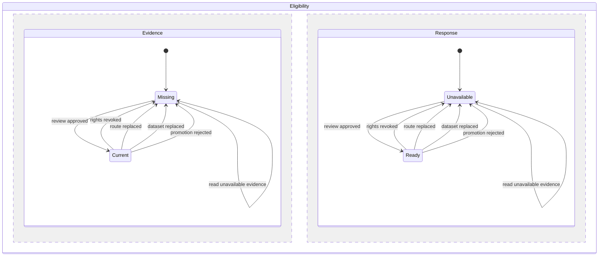

# Tour navigation evidence v1

The authenticated `GET /api/tours/detail?tour_id=<uuid>` response adds `data.routes[].navigation`.
The existing actor, tenant, and deal authorization applies unchanged. Public share responses do not gain internal evidence.

The strict type is `mcp-server/src/tour-navigation-contract.ts`. The synthetic consumer fixture is
`mcp-server/test/fixtures/tour-navigation-evidence.ts`. The app must bind its adapter to the merged producer revision.

`contract_version` equals `tour-navigation-evidence.v1`. A ready result has `reason: null` and an evidence object.
An unavailable result has `evidence: null` and a reason. Consumers hide navigation for unavailable evidence and preserve the ordered itinerary.
Reasons include unknown, unaccepted or replaced route; missing or mismatched projection; unavailable entrance or rights;
missing, rejected or stale promotion; and unavailable stop entrance evidence. A newly appended rejection supersedes an earlier approval even when backdated.

Evidence binds route UUID and integer version, projection identity and digest, latest promotion receipt identity and digest,
dataset and component registry versions, rights receipt identities, and mobile, navigation, offline and required-check evidence.
Stops carry stable stop and property IDs, sequence, label, exact latitude and longitude, and the sealed coordinate candidate's
source and entrance verification receipt. Positions come exclusively from those sealed candidates. No centroid or geocoder fallback exists.
The producer returns recorded component versions; the app must require the version it actually renders before enabling navigation.
The producer creates no outbound URL or return session. The later app consumer owns user-bound return state, expiry and retirement.

## System design

SQL owns eligibility and immutable evidence joins. The existing HTTP adapter passes the object through without extra queries.
An alternative worker-side reconciliation would duplicate eligibility and add round trips, so eligibility stays in PostgreSQL.
The helper is private. The migration preserves the installed authorization wrapper and grants through an asserted function-body extension.
Reads use one transaction. Rights and newest promotion are checked at read time; failure refuses navigation. No stale cache is served.
There are no new writes, queues, external calls, retries or circuit breakers. Existing HTTP request limits apply.
At ten times the load, historical route aggregation remains the first limit. Tenant, projection and route indexes support the joins.
No network N+1 is introduced; one private helper evaluates each route in the existing history read.

The eligibility chart models atomic detail reads, not cached app state. Evidence changes become visible on the next read.
The PostgreSQL suite exercises missing promotion, approved exact evidence, route replacement, rights revocation, dataset replacement, and a backdated rejection through the real detail read.
The deal-access suite exercises refusal through HTTP. App navigation and return transitions are outside this producer unit.

PRODUCTION PROOF: `python3 tools/prove-tour-navigation.py --merge-sha <containing-merge> --tour-id <approved-tour> --route-id <accepted-route> --cookie-jar <authenticated-Netscape-cookie-file>`
uses `lib/release_reader.py`, checks release ancestry, the exact evidence contract version and one route. Exit 0 means passing;
exit 1 means a containing release violates an assertion; exit 78 means evidence is insufficient. A qualifying production route and
authenticated session are required. Actual device handoff and app return require the later app release and device observation.
