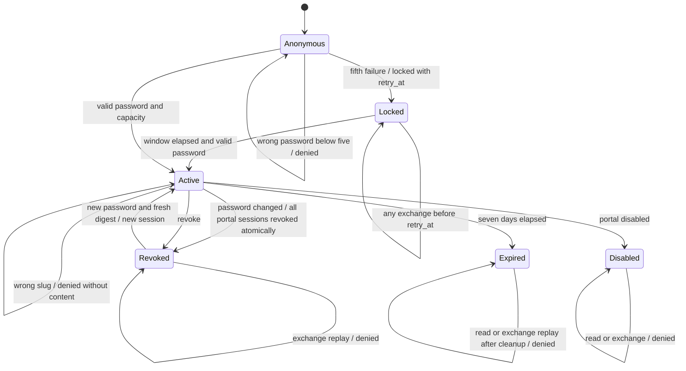

# System design

Card: WR227.S8.J1

Size medium. Postgres owns the slug binding, existing bcrypt verifier and shared
five failures in fifteen minutes allowance, plus digest-only sessions. Unit B
owns random 256-bit tokens, SHA-256 digests, cookies, request validation and HTTP.
The SQL interface has exchange, read and revoke. The canonical projection is
factored out of the existing password reader into a private helper in this new
migration. No credential scheme or projection is invented. The data shape is a digest-keyed
row with one immutable slug, creation time, fixed expiry and optional revocation.
Design compared twice: reusing password reads for every request would require
retaining passwords; copying the projection would drift. A private projection
helper preserves one implementation while the three public functions hide locks
and accounting. Boundary discipline keeps validation in SQL entry points; type
discipline uses constraints for digest and expiry. Idempotency preserves expiry
and the original revocation timestamp.

Capacity is a design bound, not a measured traffic claim. At current load and
10x, ten unexpired sessions per portal and seven-day fixed expiry bound each
slug's storage and exchange work. Expired rows are removed on that slug's next
successful new exchange. Idle slugs retain at most ten authorization rows. A private digest/slug
tombstone remains for every issued digest, preventing reissuance after cleanup.
Tombstone storage grows linearly with successful distinct logins. At 10x logins
it grows 10x; indexed single-key lookups remain the access pattern. There is no
measured production load in this synthetic build. Storage monitoring and normal
database capacity planning apply; tombstones must not be pruned while this
contract promises indefinite replay safety. Revoked rows remain
until expiry so a retry cannot resurrect them. Replay never reissues a digest, including after expiry cleanup; adapters must
never reuse a digest for a new login. Capacity
returns denied rather than evicting another browser. Bcrypt CPU breaks first at
10x; apply adapter admission limits before increasing database capacity.

Load spreads by slug. Existing verification performs bcrypt before taking its
slug row lock. Exchange holds that lock through replay, cleanup and insert.
Read and revoke lock the same slug to order against exchange, disable and password changes.
A password-hash update trigger revokes the slug's sessions inside that update's
transaction. It preserves existing revocation and expiry timestamps. No
cross-slug lock or fan-out. Storage uses digest primary key and slug/expiry
index. One set-based canonical projection, capped at 100 materials, has no N+1.

Caching n/a: every read checks live session, portal and client state. Eviction
n/a: no cache. Async and queues n/a: all effects are transactional. External
calls n/a: SQL makes none. The later adapter must fail closed on database errors,
use a finite timeout and admission limit, and alert on database failure; this
unit propagates database errors rather than returning content.

Availability is sequential authentication then issuance, and live authorization
then projection. Database outage refuses; no stale or fallback content. Strong
consistency per slug uses row locks. Revocation and expiry refuse immediately
on the next transaction. Disabled, merged, deleted and reassigned clients refuse.
No network retry loop. Password work shares the existing five-failure allowance.
Exchange uses the intended digest as idempotency key; replay does not extend
expiry or undo revocation. Revoke converges to revoked, including repeats.
No per-read writes except locking. Invalid boundary inputs refuse before work.

Throughput checkpoint

- Blocking first steps. Read source, define statechart, write and run red tests.
- Independent workstreams. n/a: one worker owns the coupled migration and tests.
- Shared mutable state. Serialize only the portal row and its bounded sessions.
- Smallest safe decomposition. One owner; adapter and host wiring stay later.

## Statechart

Tests cross the SQL interface for every transition, concurrent failures,
shared password allowance, capacity, cleanup, indexed lookup, private grants,
projection identity, private sentinels and database-error propagation. Structural
assertions cover the no-cache/no-queue/no-external-call design; future adapter
outage handling and observed 10x capacity remain unit B verification.

## Password rotation regression

An administrative password-hash change revokes all existing sessions for that
portal in the same transaction. Rollback restores both password and sessions.
Updating the hash to itself retains sessions. Existing revocation timestamps and
fixed expiry never move. Other portals remain usable. A new digest and the new
password can establish a new session; a revoked digest cannot be reused.
The `password changes atomically revoke all sessions only for that portal` test
derives these transitions from the chart and exercises administrative SQL plus
the existing exchange/read interface. The repeated-revoke test compares exact
PostgreSQL timestamp text across separate transactions to retain microseconds.
No HTTP rotation interface, transport or production behavior is modeled here.
