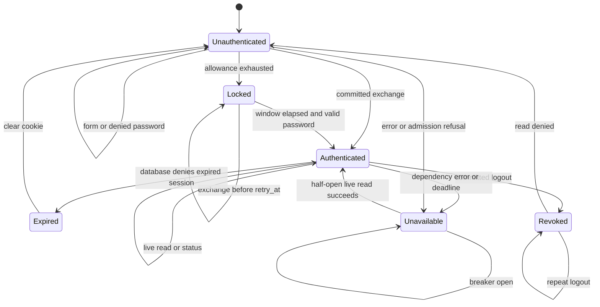
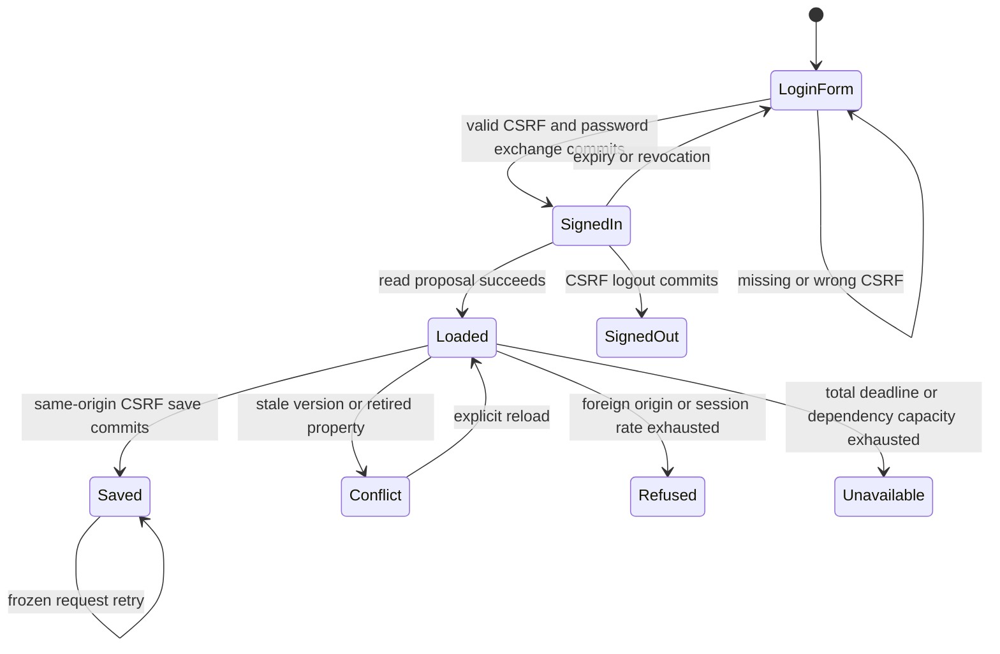

# System design

Card: WR227.S9.J1

Medium HTTP module. Data shape is a Fetch Request mapped to a Response through
exchange/read/revoke result variants from client-portal-session.v1. HTTP owns
parsing, cookies, CSRF, bounds and escaped rendering. Postgres owns authorization,
passwords, lockout, expiry, revocation and the canonical projection. The injected
safeProjection seam redacts canonical content. No browser Request or headers
crosses a database seam. Only exchange receives a transient password.

Interface considered twice. Owning database connections here would couple HTTP
to transaction policy. Choose an injected Fetch handler instead. Future adapters
MUST use parameterized authenticated carr_writer calls, read-write transactions
even for reads, commit denied and locked outcomes, and resolve only after commit.
They must implement finite statement/transaction timeouts and honor AbortSignal.
This unit has no MCP or database network client.

Capacity and scaling. No measured production traffic claim. Defaults admit eight
concurrent dependencies and 128 requests per instance with no waiting queue.
At 10x bcrypt CPU and database capacity break first. Load spreads by slug across
instances. Each instance permits ten logins and 120 other actions per slug per
minute, with at most 1024 rate buckets. Expired buckets are swept on admission.
Integration must add distributed/IP ingress limits because local limits multiply
with instances. The database's password lockout remains shared fleet-wide.

Caching and eviction. No content cache, session cache or stale fallback. Every
response is private, no-store. Cookies expire within seven days and no later
than committed SQL expiry. SameSite=Lax allows links opened from email; exact
Origin checks protect every mutation. Per-slug host-only cookies allow two
portals in one browser. Secure, HttpOnly, Path=/, no Domain.

Availability and consistency. At most one database call and one safe projection
call per request, sequentially. Each dependency has a 3s deadline. Three failures
open that dependency's breaker for 30s; one half-open probe can recover. Every failure and
saturation emits only a fixed operational reason code and returns 503. A timeout
aborts the operation but retains its slot until settlement, bounding even a
dependency that ignores cancellation. No automatic retry. Live reads refuse on
expiry, revocation, disable or database outage. Status also authorizes live.

Storage and N+1. One SQL operation per action; canonical projection caps materials
at 100 in unit A. No per-material fetch, selectors or fan-out. Async/queues n/a:
responses wait for committed results. External APIs n/a: only injected operations.
Every write has a natural key: exchange uses a fresh random 256-bit token's
SHA-256 digest; revoke uses slug and digest. Tokens/digests are never reused for
new exchanges. Repeated logout converges to a cleared cookie. Lost exchange
responses leave a bounded SQL session until expiry. Failed revoke retains the
cookie and returns 503 so a later explicit logout can try again.

Routes are GET /slug (redirect), GET /slug/ (form or escaped canonical content),
POST /slug/login (bounded URL-encoded password), GET /slug/status and POST
/slug/logout. Package, file and selection routes return 501. Publication and
partner upload routes are unreachable. Unknown queries, encoded paths and
dot segments refuse. Fetch may normalize dot segments before the handler sees
them; the normalized route still requires its own slug's live authorization.

Throughput checkpoint. Read contract, chart, red tests, implementation, focused
checks, clean-environment rerun. One worker, no fan-out. Shared state is bounded
admission, breaker and rate buckets. Worker wiring and production proof are later.

Tests derive from these transitions with synthetic contract adapters. SQL expiry
and lockout correctness belong to unit A. These tests prove HTTP mapping and
bounds, not database integration or production availability.

## J3 reconciliation before implementation

Card: WR227.S9.J3

The final host keeps one Fetch seam and adds a PostgreSQL adapter using the
registered exchange/read/revoke operations and portalProposalStorage. Session
state stays exclusively in SQL. CSRF is domain-separated SHA-256 of the opaque
cookie token, exposed by status/page; an anonymous per-slug CSRF cookie protects
login forms. Every write requires that state and exact Origin. Proposal routes
are GET/POST /<slug>/proposals/<publication UUID>; POST binds an explicit frozen
publication_version and request. SQL checks publication ownership and membership.
No deal or client selector crosses the seam. No mounting or deploy in this job.

Request lifetime has one total deadline covering body plus all dependencies.
Each dependency retains its concurrency slot until settlement even after timeout.
Per-session action buckets prevent one browser from consuming another's allowance;
anonymous/login buckets stay per slug. No automatic retry, content cache or queue.
At current and 10x load, admission refuses rather than queues; distributed ingress
limits remain a staging mount requirement. Database transaction deadlines are
required of the injected writer and are set locally by the SQL adapter.

## Current contract and coverage

The J1 text above records the retained branch's starting design. J3 supersedes
its per-slug action limits, per-dependency deadlines, missing CSRF state and
lack of SQL transport. The current reference is docs/client-portal/portal-http.md.
J3 also preserves explicitly published items from client-publications.v1; it
never restores automatic live roadmap phases.

| Transition | Executed test |
| --- | --- |
| Form, deny, lock, issue | login CSRF lockout and per-slug sessions |
| Two active portals | login CSRF lockout and per-slug sessions |
| Revoke, repeat, read denied | logout CSRF revocation repeat and clearing |
| Expire or disable, refuse replay | disabled, expired and reassigned portals refuse before replay |
| Read, save, replay, reload, conflict, retired | HTTP issue, proposal round trip, refusals and revoke through real SQL |
| CSRF and origin refuse | origin paths methods and body bounds; HTTP issue, proposal round trip, refusals and revoke through real SQL |
| Rate refuse and eviction | session rate limits isolate browsers and buckets evict |
| Deadline, retained slot | deadline retains slot until ignored cancellation settles |
| Saturation and body deadline | bounded request admission and streamed body deadline |
| Breaker open, cooldown, recover | breaker cooldown and live recovery |
| Safe rendered publications | projection retains published items and escapes content with secure cookie bounds |

The chart guides executable HTTP and real PostgreSQL tests. It is not a formal
TLC model and makes no claim about deployed routing or distributed ingress.

Design and debt pass. A combined Fetch/SQL module keeps the public caller at
createPortalHost(connectionString, configuredOrigin). Tests use the same Fetch
interface with the real registered SQL adapter. An alternative separate host
controller would require callers to coordinate transaction and admission state;
that complexity stays inside this module. Removed the held JS/MJS copies and
its obsolete manual duration entry, replacing them with strict TypeScript.
No second auth scheme, compatibility proposal store, or generic routing framework.
